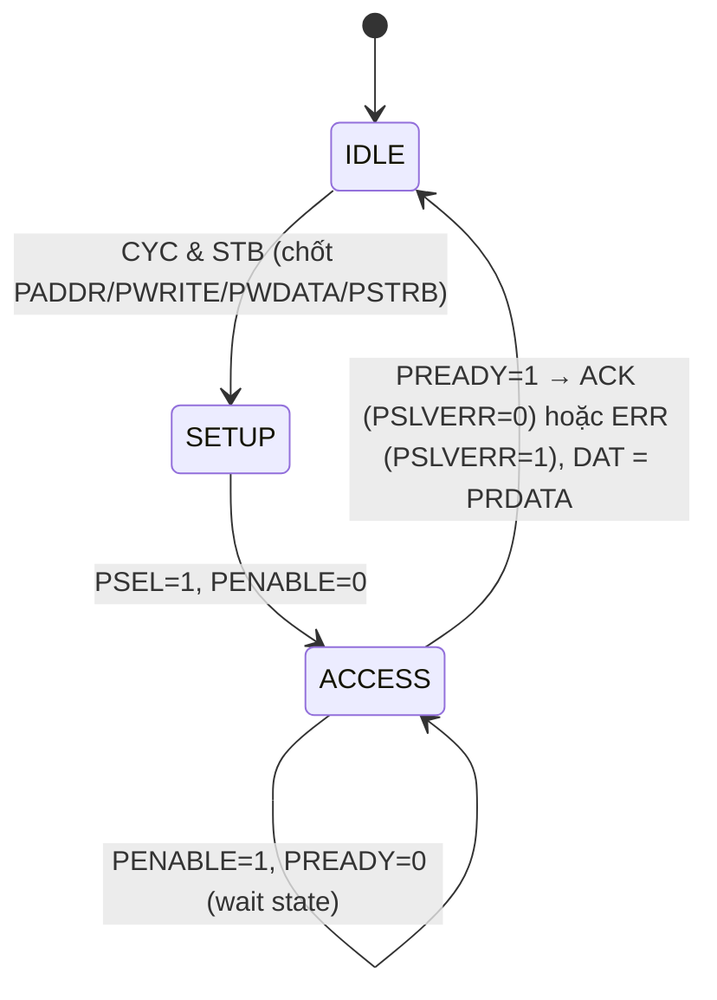

# Bộ nhớ và bus (`rtl/mem/ram_dp.sv`, `rtl/bus/dbus_xbar.sv`, `rtl/bus/apb_bridge.sv`)

## Bus Wishbone B4 classic

Bốn liên kết: lõi → cổng lệnh RAM (`ibus`), lõi → `dbus_xbar` (`dbus`), `dbus_xbar` → cổng dữ liệu RAM,
`dbus_xbar` → `apb_bridge`. Tín hiệu master: `CYC, STB, WE, SEL[3:0], ADR[31:0], DAT_O` → slave trả
`DAT_I, ACK, ERR`.

- Một giao dịch = `CYC & STB` cho tới khi slave trả `ACK` (xong) hoặc `ERR` (lỗi → access fault). Master **giữ
  nguyên** mọi tín hiệu trong thời gian chờ; `ACK` và `ERR` loại trừ nhau.
- Slave RAM trả `ACK` **ngay trong chu kỳ yêu cầu** (Wishbone classic cho phép) → không thêm chu kỳ nào; cầu APB trả
  sau ≥ 3 chu kỳ.
- Bus lệnh: `CYC = STB = 1` sau reset, mỗi chu kỳ lấy một lệnh; IF chỉ nhận lệnh khi có `ACK/ERR`. Khác chuẩn duy
  nhất: `ADR` có thể căn 2 byte, slave trả 32 bit bắt đầu tại đó.
- **Vì sao Wishbone (D28)?** OBI và AXI bắt pha phản hồi sớm nhất ở chu kỳ sau → phải tách IF thành 2 tầng và đưa dữ
  liệu load về WB, CPI tăng. Wishbone classic cho phản hồi cùng chu kỳ nên giữ nguyên mọi số liệu hiệu năng (đã kiểm:
  số chu kỳ 9 benchmark trùng khớp trước/sau).
- Kiểm chứng: `tb/bfm/wb_checker.sv` theo dõi cả 4 liên kết trong mọi mô phỏng `tb_soc` (vi phạm → FAIL);
  `tb_dbus_xbar` (unit) truy cập ngẫu nhiên RAM/APB/vùng trống.

## `ram_dp` – RAM 128 KB, đọc tổ hợp, ghi đồng bộ

- Cổng I (slave Wishbone chỉ đọc): `addr[1] = 0` → `word[i]`; `addr[1] = 1` → `{word[i+1][15:0], word[i][31:16]}`;
  ngoài RAM → `ERR`.
- Cổng D (slave Wishbone): đọc tổ hợp, ghi theo `SEL` ở cạnh clock, `ACK = CYC & STB` (không wait state).
- `RAM_SYNC = 1` (FPGA, D27): 2 bank 16 bit chạy cạnh xuống – cùng hành vi chu kỳ, dùng được block RAM đồng bộ.
- Mô phỏng: nạp `$readmemh` từ `+hex=`; tổng hợp: black box (không tính diện tích).

**Vì sao đọc tổ hợp?** Đọc được 32 bit bắt đầu ở bất kỳ địa chỉ chẵn trong **một** chu kỳ → lệnh 32 bit vắt qua
ranh giới word không cần prefetch buffer; IF biết ngay lệnh 16 hay 32 bit để dự đoán PC kế cùng chu kỳ. Trên FPGA
tương ứng LUTRAM (distributed RAM). Nhược điểm: không dùng được Block RAM/SRAM đồng bộ (có độ trễ đọc 1 chu kỳ) và
đường đọc RAM nằm trên đường tổ hợp IF/MEM (với lõi single-cycle đó chính là đường găng, xem
`results/synth/summary.md`) – hướng phát triển: SRAM đồng bộ + prefetch buffer.

## `dbus_xbar`

| Địa chỉ                   | Đích                                           |
| ------------------------- | ---------------------------------------------- |
| `0x8000_0000–0x8001_FFFF` | RAM                                            |
| `0x1000_0000–0x1000_FFFF` | APB bridge                                     |
| còn lại                   | `ERR` ngay trong chu kỳ yêu cầu → access fault |

Địa chỉ, dữ liệu, `WE`, `SEL` phát chung; chỉ slave được chọn nhận `CYC/STB`; `ACK/ERR/DAT` của nó được đưa về lõi.

## `apb_bridge` – FSM APB4

- Chốt tín hiệu khi vào SETUP để chúng ổn định suốt giao dịch (yêu cầu của APB); `PSTRB = 0` khi đọc; `PPROT = 0`.
- `PSEL` theo slot `addr[15:12]`; slot không có slave: không bật `PSEL`, tự kết thúc bằng `ERR`.
- Một truy cập tốn tối thiểu 3 chu kỳ (IDLE nhận yêu cầu → SETUP → ACCESS). Lõi giữ request trong suốt thời gian
  này; counter `mhpmcounter9` đếm chu kỳ chờ bus.
- Kiểm chứng: `tb_apb_bridge` với slave có wait state ngẫu nhiên, kiểm tra giao thức, PSLVERR, slot trống.

## Quy ước slave APB

Ghi theo `PSTRB`; thanh ghi DATA đẩy FIFO khi `PSTRB[0] = 1`; đọc có side effect (pop FIFO) đúng một lần tại chu
kỳ ACCESS; offset không định nghĩa → `PSLVERR`.
