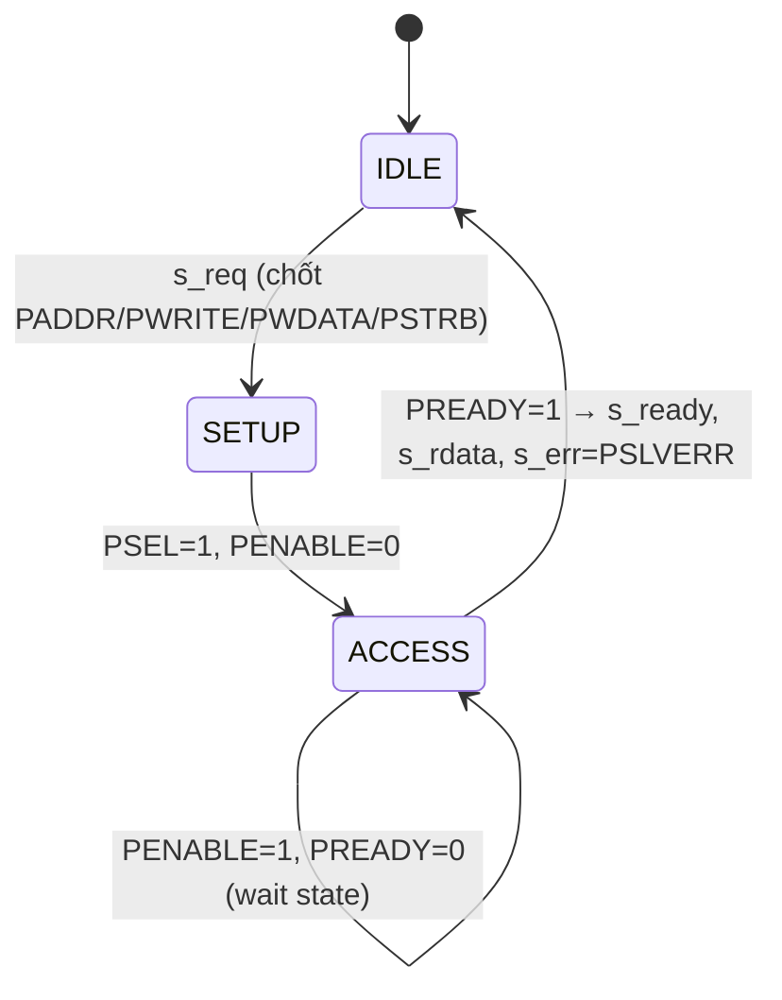

# Bộ nhớ và bus (`rtl/mem/ram_dp.sv`, `rtl/bus/dbus_xbar.sv`, `rtl/bus/apb_bridge.sv`)

## `ram_dp` – RAM 128 KB, đọc tổ hợp, ghi đồng bộ

- Cổng I: `addr[1] = 0` → `word[i]`; `addr[1] = 1` → `{word[i+1][15:0], word[i][31:16]}`; ngoài RAM → `ibus_err`.
- Cổng D: đọc tổ hợp, ghi theo byte enable ở cạnh clock, `ready = req` (không wait state).
- Mô phỏng: nạp `$readmemh` từ `+hex=`; tổng hợp: black box (không tính diện tích).

**Vì sao đọc tổ hợp?** Đọc được 32 bit bắt đầu ở bất kỳ địa chỉ chẵn trong **một** chu kỳ → lệnh 32 bit vắt qua
ranh giới word không cần prefetch buffer; IF biết ngay lệnh 16 hay 32 bit để dự đoán PC kế cùng chu kỳ. Trên FPGA
tương ứng LUTRAM (distributed RAM). Nhược điểm: không dùng được Block RAM/SRAM đồng bộ (có độ trễ đọc 1 chu kỳ) và
đường đọc RAM nằm trên đường tổ hợp IF/MEM (với lõi single-cycle đó chính là đường găng, xem
`results/synth/summary.md`) – hướng phát triển: SRAM đồng bộ + prefetch buffer.

## `dbus_xbar`

| Địa chỉ | Đích |
|---|---|
| `0x8000_0000–0x8001_FFFF` | RAM |
| `0x1000_0000–0x1000_FFFF` | APB bridge |
| còn lại | trả ngay `ready = 1, err = 1` → access fault |

## `apb_bridge` – FSM APB4

- Chốt tín hiệu khi vào SETUP để chúng ổn định suốt giao dịch (yêu cầu của APB); `PSTRB = 0` khi đọc; `PPROT = 0`.
- `PSEL` theo slot `addr[15:12]`; slot không có slave: không bật `PSEL`, tự trả `PREADY = 1, PSLVERR = 1`.
- Một truy cập tốn tối thiểu 3 chu kỳ (IDLE nhận yêu cầu → SETUP → ACCESS). Lõi giữ request trong suốt thời gian
  này; counter `mhpmcounter9` đếm chu kỳ chờ bus.
- Kiểm chứng: `tb_apb_bridge` với slave có wait state ngẫu nhiên, kiểm tra giao thức, PSLVERR, slot trống.

## Quy ước slave APB

Ghi theo `PSTRB`; thanh ghi DATA đẩy FIFO khi `PSTRB[0] = 1`; đọc có side effect (pop FIFO) đúng một lần tại chu
kỳ ACCESS; offset không định nghĩa → `PSLVERR`.
