# UART (`rtl/periph/uart/uart_apb.sv`, `uart_tx.sv`, `uart_rx.sv`, `rtl/periph/sync_fifo.sv`)

## Cấu trúc

```
APB ─> [DATA write] ─> TX FIFO (16) ─> uart_tx ─> uart_tx pin
APB <─ [DATA read]  <─ RX FIFO (16) <─ uart_rx <─ uart_rx pin (2 FF sync)
             STATUS / CTRL / BAUD_DIV / IRQ_EN / IRQ_STATUS / WATERMARK
```

Khung: start (0) – 8 bit dữ liệu LSB trước – parity tùy chọn (chẵn/lẻ) – 1 hoặc 2 stop (1).
1 bit = 16 × (BAUD_DIV + 1) chu kỳ clock; BAUD_DIV = 26 → 432 chu kỳ/bit ≈ 115 740 baud ở 50 MHz (sai số 0,5%).

## Bộ phát `uart_tx`

FSM `IDLE → START → DATA(8) → [PARITY] → STOP(1|2) → IDLE`. Bộ chia riêng khởi động lại ở đầu mỗi khung nên độ dài
mỗi bit chính xác. Lấy byte mới từ TX FIFO khi IDLE và `TX_EN = 1`.

## Bộ thu `uart_rx` – lấy mẫu ×16

```mermaid
stateDiagram-v2
  [*] --> IDLE
  IDLE --> START: rx_sync = 0 (cạnh xuống), reset bộ chia
  START --> IDLE: sau 8 tick rx = 1 (start giả - glitch)
  START --> DATA: sau 8 tick rx = 0 (giữa start bit)
  DATA --> DATA: mỗi 16 tick lấy 1 bit (giữa bit)
  DATA --> PARITY: đủ 8 bit, có parity
  DATA --> STOP: đủ 8 bit, không parity
  PARITY --> STOP: 16 tick, kiểm parity
  STOP --> IDLE: 16 tick, lấy stop: 0 → frame error; đẩy byte
```



- **Đồng bộ 2 FF**: tín hiệu `uart_rx` đến từ bên ngoài, không đồng bộ với clock; 2 FF giảm xác suất metastability.
- **Vì sao ×16 và lấy giữa bit?** Lấy mẫu dày cho phép xác định cạnh start với sai số ≤ 1/16 bit; lấy ở giữa bit
  (8 tick sau cạnh, rồi mỗi 16 tick) cho biên độ chịu lệch baud và nhiễu lớn nhất.
- **Kiểm tra lại start bit ở giữa**: xung nhiễu ngắn hơn nửa bit không tạo byte rác (`tb_uart` kiểm tra).

## Cờ và ngắt

- STATUS: TX_FULL/EMPTY/IDLE, RX_EMPTY/FULL, RX_OVERRUN, FRAME_ERR, PARITY_ERR, TX_LEVEL, RX_LEVEL.
- Overrun: byte nhận khi RX FIFO đầy bị bỏ, đặt cờ (16 byte đầu được giữ – `uart_irq_echo` kiểm tra).
- IRQ_STATUS: TX_WM (TX_LEVEL ≤ ngưỡng, theo mức), RX_WM (RX_LEVEL ≥ ngưỡng, theo mức), ERR (dính, W1C – xóa luôn
  các cờ lỗi). `irq = |(IRQ_STATUS & IRQ_EN)` nối vào INTC bit 0.
- Ngắt theo **mức** giúp ISR đơn giản: ISR đọc tới khi RX FIFO rỗng thì nguồn ngắt tự hết.

## Driver (`sw/drivers/uart.c`)

Polling: `uart_putc` (chờ !TX_FULL), `uart_getc`, `uart_flush` (chờ TX_IDLE). Ngắt: `uart_rx_irq_start` đặt
RX_WM_LVL = 1, ISR `uart_isr` đổ FIFO vào ring buffer 64 byte.
