# SPI master (`rtl/periph/spi/spi_apb.sv`, `spi_master.sv`)

## Bốn mode

| Mode | CPOL | CPHA | SCLK nghỉ | Lấy mẫu MISO | Đổi MOSI |
|---|---|---|---|---|---|
| 0 | 0 | 0 | thấp | cạnh lên (leading) | cạnh xuống (trailing); bit đầu đặt trước cạnh đầu tiên |
| 1 | 0 | 1 | thấp | cạnh xuống (trailing) | cạnh lên (leading) |
| 2 | 1 | 0 | cao | cạnh xuống (leading) | cạnh lên (trailing) |
| 3 | 1 | 1 | cao | cạnh lên (trailing) | cạnh xuống (leading) |

"Leading" = cạnh rời mức nghỉ. CPOL chỉ đổi mức nghỉ; CPHA quyết định lấy mẫu ở cạnh thứ nhất hay thứ hai.
Flash W25Q chạy mode 0 và 3 – hai mode cùng "lấy mẫu cạnh lên, đổi dữ liệu cạnh xuống".

## FSM của `spi_master`

```mermaid
stateDiagram-v2
  [*] --> IDLE
  IDLE --> XFER: EN && TX FIFO có byte (pop; CPHA=0: đặt bit đầu lên MOSI)
  XFER --> XFER: mỗi nửa chu kỳ (CLK_DIV+1 clk) đảo SCLK; cạnh chẵn = leading, lẻ = trailing
  XFER --> GAP: sau cạnh thứ 16
  GAP --> XFER: hết nửa chu kỳ, còn byte (đẩy byte nhận, nạp byte mới)
  GAP --> IDLE: hết nửa chu kỳ, TX FIFO rỗng (đẩy byte nhận, DONE)
```

- f_SCLK = f_clk / (2 × (CLK_DIV + 1)); `tb_spi` đo nửa chu kỳ SCLK cho 3 giá trị CLK_DIV.
- LSB-first: đảo bit byte gửi trước khi dịch và đảo byte nhận khi giao (bộ dịch luôn dịch MSB trước).
- Nửa chu kỳ "GAP" sau mỗi byte cho slave thời gian giữ dữ liệu và bảo đảm bit đầu của byte kế (CPHA = 0) xuất hiện
  trước cạnh đầu tiên.

## Thanh ghi và ngắt

- CS điều khiển bằng phần mềm (`CS` register, tích cực thấp) – giữ CS suốt một lệnh flash nhiều byte.
- STATUS: TX_FULL/EMPTY, RX_EMPTY/FULL, BUSY, RX_OVERRUN, mức FIFO.
- IRQ: TX_EMPTY và RX_NOT_EMPTY (mức), DONE (dính, đặt khi byte cuối xong và TX FIFO rỗng, W1C),
  OVERRUN (dính, W1C). DONE cho phép CPU nạp ≤ 16 byte rồi `wfi` tới khi xong (`spi_xfer_buf_irq`).

## Kiểm chứng

- `tb_spi`: 4 mode × MSB/LSB × 3 CLK_DIV với `spi_slave_bfm`; MOSI kiểm ở slave, MISO kiểm qua RX FIFO.
- System test `spi_modes` (slave chế độ echo: trả `byte_trước ^ 0x5A` → kiểm cả hai chiều từ firmware) và
  `spi_flash` (JEDEC ID, erase, program, read, WIP, ngắt DONE, mode 3).
