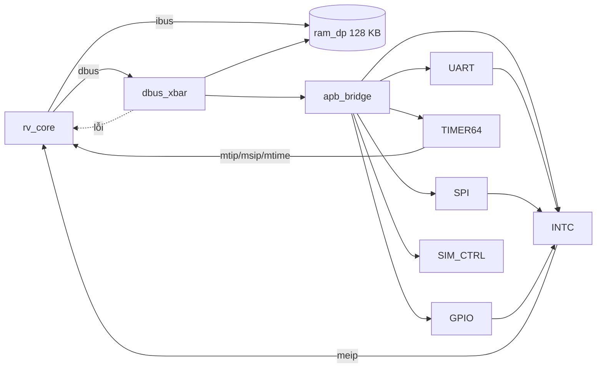

# Vi kiến trúc lõi `rv_core` và SoC

Tài liệu mô tả cách hiện thực (vi kiến trúc). Đặc tả chức năng: `docs/spec.md`; quyết định thiết kế: `docs/decisions.md`.

## 1. Sơ đồ pipeline

```mermaid
flowchart LR
  subgraph IF
    PC[pc_q] --> IBUS[ibus_addr]
    BP[BHT + BTB<br/>BP_MODE 2] --> NPC[chọn PC kế]
  end
  subgraph ID
    CD[compressed_decoder] --> DEC[decoder + imm_gen]
    RF[(regfile 2R1W<br/>write-through)]
  end
  subgraph EX
    FWD[forward mux] --> ALU
    FWD --> BR[branch_unit<br/>actual_npc]
    FWD --> MD[muldiv]
  end
  subgraph MEM
    LSU --> DBUS[dbus]
    CSR[csr_file<br/>trap / mret]
  end
  subgraph WB
    WR[ghi regfile<br/>minstret, hpm<br/>commit log]
  end
  IF -->|if_id| ID -->|id_ex| EX -->|ex_mem| MEM -->|mem_wb| WB
  WB -. mem_wb .-> FWD
  MEM -. ex_mem .-> FWD
  BR -. sai dự đoán .-> NPC
  CSR -. trap/mret/fence.i .-> NPC
  DEC -. redirect ID .-> NPC
```

| File | Nội dung |
|---|---|
| `rtl/core/rv_core.sv` | nối các tầng, regfile, predictor, CSR, hazard |
| `rtl/core/if_stage.sv` | `pc_q`, phát hiện lệnh 16 bit, dự đoán IF, mux PC kế, thanh ghi `if_id` |
| `rtl/core/id_stage.sv` | giải nén C, decode, imm, ngoại lệ ID, redirect ID, thanh ghi `id_ex` |
| `rtl/core/ex_stage.sv` | forward mux, ALU, branch, MulDiv, phát hiện sai dự đoán, cập nhật predictor, `ex_mem` |
| `rtl/core/mem_stage.sv` | LSU, CSR RMW, trap/ngắt (điểm commit), MRET, FENCE.I, `mem_wb` |
| `rtl/core/wb_stage.sv` | ghi regfile, retire, sự kiện hiệu năng, commit log |
| `rtl/core/hazard_unit.sv` | stall / flush / redirect |
| `rtl/core/forward_unit.sv` | chọn nguồn forward |

## 2. Thanh ghi pipeline

Mỗi thanh ghi có `valid`. Mọi lệnh mang theo `pc`, mã lệnh gốc (`insn`, 16 bit với lệnh nén), `is_c`, `pred_npc`,
và thông tin ngoại lệ (`exc`, `exc_cause`, `exc_tval`).

| Thanh ghi | Trường chính |
|---|---|
| `if_id` | `pc`, 32 bit đọc từ RAM, `is_c`, `pred_npc`, `fault` (ibus_err) |
| `id_ex` | điều khiển đã decode, `rs1/rs2` (chỉ số + giá trị), `imm`, `rd`, `rd_we`, cờ lớp lệnh, ngoại lệ |
| `ex_mem` | `result` (ALU / MulDiv / link), `opnd` (dữ liệu store hoặc toán hạng CSR), `funct3`, cờ load/store/CSR/MRET/FENCE.I, cờ hiệu năng (`is_branch`, `is_jump`, `mispred`) |
| `mem_wb` | `result` cuối (ALU / load / CSR), `rd`, thông tin store cho commit log, cờ hiệu năng, `instret_noinc` |

Lệnh mang ngoại lệ được coi như NOP ở các tầng sau: ID xóa mọi cờ có side effect khi ghi `id_ex`.

## 3. Điều khiển: stall, flush, redirect (`hazard_unit`)

```
load_use  = ID dùng rs = rd của lệnh load/CSR đang ở EX
stall_mem = bus_wait                       (dbus_req && !dbus_ready)
stall_ex  = bus_wait || md_stall
stall_id  = stall_ex || load_use
stall_if  = stall_id
ex_redirect = sai_dự_đoán_EX && !stall_ex && !mem_redirect
id_redirect = yêu_cầu_ID && !stall_id && !ex_redirect && !mem_redirect
flush_if_id  = mem_redirect || ex_redirect || id_redirect
flush_id_ex  = mem_redirect || ex_redirect || (stall_id && !stall_ex)   # bubble khi load-use
flush_ex_mem = mem_redirect || (stall_ex && !stall_mem)                 # bubble khi MulDiv bận
flush_mem_wb = mem_trap || stall_mem                                    # bubble khi chờ bus
```

Quy tắc: flush thắng stall; tầng già hơn thắng. Redirect từ ID/EX chỉ xảy ra đúng một lần, ở chu kỳ lệnh rời tầng.
Khi EX bị stall, `id_ex` vẫn giữ lệnh nhưng chép giá trị toán hạng đã forward (decision D4) để không mất dữ liệu khi
lệnh nguồn ở WB retire.

Chọn PC kế (IF): `trap/mret/fence.i (MEM) > sai dự đoán (EX) > redirect (ID) > giữ (stall) > dự đoán IF > tuần tự`.

## 4. Forwarding

| Nguồn | Điều kiện | Dữ liệu |
|---|---|---|
| `ex_mem` | `mem_valid && mem_rd_we && rd ≠ 0 && !load && !CSR` | kết quả ALU / MulDiv / link |
| `mem_wb` | `wb_valid && wb_rd_we && rd ≠ 0` | mọi loại kết quả (kể cả load, CSR) |

`ex_mem` được ưu tiên vì giữ lệnh trẻ hơn (giá trị mới nhất của thanh ghi). Load/CSR không forward từ `ex_mem` vì dữ
liệu chỉ có ở cuối MEM; trường hợp phụ thuộc liền kề được chặn bởi stall load-use 1 chu kỳ. Ghi `rd` ở WB và đọc ở
ID trong cùng chu kỳ được xử lý bởi regfile write-through.

## 5. Dự đoán rẽ nhánh

| BP_MODE | IF | ID | EX |
|---|---|---|---|
| 0 | tuần tự | – | sửa sai (2 chu kỳ) |
| 1 | tuần tự | JAL → `pc+imm`; branch tra BHT theo PC ở ID, nếu taken → `pc+imm` (1 bubble) | sửa sai, cập nhật BHT |
| 2 | BTB hit và (JAL/JALR hoặc BHT taken) → đích BTB | JAL chưa được BTB đoán → redirect | sửa sai, cập nhật BHT/BTB, xóa entry alias |

- BHT: counter 2 bit bão hòa, reset `01`, chỉ số `pc[log2 N:1]`.
- BTB: direct-mapped, `{valid, tag, target[31:1], type}`, cấp phát khi nhảy taken; JALR dùng đích lần trước.
- Phát hiện sai thống nhất: `actual_npc != pred_npc` ở EX. Vì so sánh **địa chỉ kế tiếp thật** với **địa chỉ đã
  dự đoán**, mọi loại sai (hướng nhánh, đích JALR, lệnh không phải nhánh bị BTB đoán nhảy do alias, độ dài lệnh) đều bị
  bắt bởi cùng một bộ so sánh.

## 6. Extension M và C

- Nhân 33×33 có dấu tổ hợp trong EX (1 chu kỳ). Chia radix-2 32 vòng, FSM `IDLE/BUSY/DONE` (D5); chia cho 0 và tràn
  trả kết quả ngay.
- RAM ghép sẵn 32 bit từ địa chỉ căn 2 byte (`{word[i+1][15:0], word[i][31:16]}`), nên lệnh 32 bit vắt qua ranh giới word
  được đọc trong 1 chu kỳ; IF chỉ cần xét `rdata[1:0] != 11` để biết độ dài và tính `pc + 2/4`.
- Giải nén ở ID (`compressed_decoder`) để IF ngắn.

## 7. CSR, ngoại lệ và ngắt tại MEM

MEM là điểm commit: mọi lệnh già hơn đã hoàn tất, lệnh trẻ hơn chưa thay đổi trạng thái kiến trúc → ngoại lệ chính xác.
Store, ghi CSR, MRET chỉ có hiệu lực khi lệnh không trap. Ngắt được nhận khi
`MIE && |(mip & mie) && mem_valid && !mem_exc && !mem_bus_started`; lệnh ở MEM bị hủy, `mepc` = PC của nó.
`dbus_req` bị chặn bởi `take_irq` trong cùng chu kỳ nên không có giao dịch bus nào bắt đầu cho lệnh sắp bị hủy.
Hệ quả: khi bộ chia đang chạy, MEM là bubble nên ngắt chờ tới khi DIV tới MEM, rồi hủy và chạy lại DIV sau MRET
(test `irq_during_div`).

## 8. SoC



APB bridge: `IDLE → SETUP → ACCESS (chờ PREADY) → IDLE`, tối thiểu 3 chu kỳ/truy cập; slot không có slave trả
`PSLVERR`. Reset: `rst_sync` (bật bất đồng bộ, nhả đồng bộ 2 FF).
