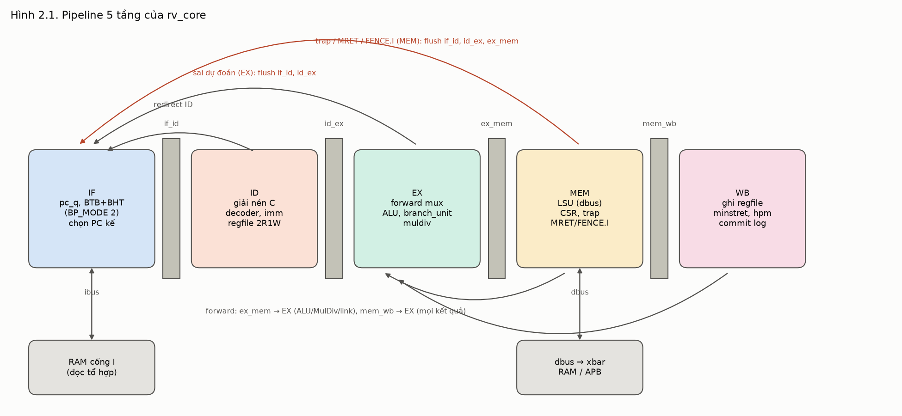
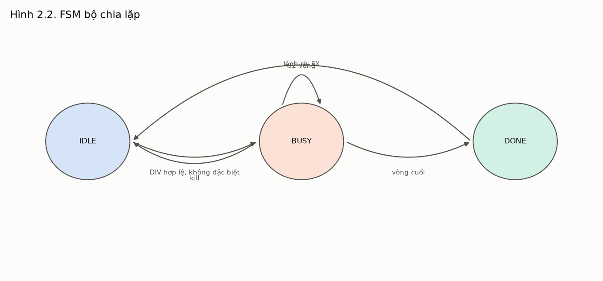

# Chương 2. Thiết kế lõi RV32IMC pipeline 5 tầng

## 2.1. Yêu cầu và tham số

Lõi `rv_core` hiện thực RV32I + M + C + Zicsr + Zifencei + Zicntr, chỉ Machine mode. Các tham số cấu hình được
liệt kê ở Bảng 2.1; chúng cho phép cùng một mã RTL tạo ra các biến thể dùng trong ma trận xác minh và thí nghiệm.

Bảng 2.1. Tham số của `rv_core` (nguồn: `rtl/core/rv_core.sv`).

| Tham số | Mặc định | Ý nghĩa |
|---|---|---|
| `RESET_PC` | `0x8000_0000` | địa chỉ lệnh đầu tiên |
| `ENABLE_M` | 1 | 0: lệnh M là illegal |
| `ENABLE_C` | 1 | 0: lệnh 16 bit illegal; nhảy tới địa chỉ có bit 1 = 1 gây instruction-address-misaligned |
| `BP_MODE` | 2 | 0 tĩnh not-taken; 1 BHT tra ở ID; 2 BHT + BTB tra ở IF |
| `BHT_ENTRIES` | 256 | số counter 2 bit |
| `BTB_ENTRIES` | 32 | số entry BTB direct-mapped |

Giao tiếp của lõi gồm bus lệnh tổ hợp (`ibus_addr` → `ibus_rdata` 32 bit từ địa chỉ căn 2 byte, `ibus_err`), bus dữ
liệu có bắt tay (`dbus_req/we/be/addr/wdata` giữ nguyên tới `dbus_ready`, kèm `dbus_err`, `dbus_rdata`), ba đường
ngắt `irq_mtip/msip/meip` và giá trị `mtime` 64 bit cho CSR `time`.

## 2.2. Datapath

Hình 2.1 thể hiện datapath. Bốn thanh ghi pipeline `if_id`, `id_ex`, `ex_mem`, `mem_wb` đều có bit `valid`; ngoài
các trường điều khiển, mỗi lệnh mang theo `pc`, mã lệnh gốc (16 bit với lệnh nén – dùng cho `mtval` và commit log),
cờ `is_c`, PC kế đã dự đoán `pred_npc` và thông tin ngoại lệ. Lệnh mang cờ ngoại lệ được coi như NOP ở các tầng sau.

### 2.2.1. IF

`pc_q` được đưa thẳng ra `ibus_addr`; RAM trả 32 bit trong cùng chu kỳ. IF xác định độ dài lệnh qua hai bit thấp,
tính `seq_npc = pc + 2/4`, và ở `BP_MODE = 2` tra BTB + BHT để chọn `pred_npc`. PC kế được chọn theo ưu tiên
`trap/mret/fence.i (MEM) > sai dự đoán (EX) > redirect (ID) > giữ khi stall > dự đoán IF > tuần tự`.

### 2.2.2. ID

`compressed_decoder` mở rộng lệnh 16 bit thành lệnh 32 bit tương đương (đặt ở ID để IF ngắn). `decoder` sinh tín hiệu
điều khiển, `imm_gen` sinh hằng, regfile 2 cổng đọc – 1 cổng ghi đọc toán hạng (write-through: dữ liệu WB ghi cùng
chu kỳ được thấy ngay). ID phát hiện các ngoại lệ: instruction access fault, illegal instruction (kể cả encoding nén
dành riêng), ECALL, EBREAK. Ở `BP_MODE ≥ 1`, JAL được đổi hướng ngay ở ID (penalty 1 chu kỳ); ở `BP_MODE = 1`, nhánh
có điều kiện tra BHT theo PC ở ID và đổi hướng nếu đoán taken.

### 2.2.3. EX

Forward mux chọn toán hạng; ALU dùng một bộ trừ 33 bit chung cho SUB/SLT/SLTU; `branch_unit` so sánh nhánh và tính
`actual_npc` (`pc+imm`, `(rs1+imm)&~1` hoặc `pc+len`). Bộ nhân/chia `muldiv` (mục 2.4). Sai dự đoán được phát hiện
bằng một phép so sánh duy nhất `actual_npc != pred_npc` cho mọi chế độ dự đoán, sau đó flush `if_id`, `id_ex` (penalty
2 chu kỳ). Predictor được cập nhật tại đây, chỉ cho lệnh hợp lệ không bị flush.

### 2.2.4. MEM

LSU tính byte enable, kiểm tra căn lề (trap, không phát request), giữ request tới `dbus_ready`, căn chỉnh và mở rộng
dấu dữ liệu load ngay trong MEM. CSR được đọc–sửa–ghi tại MEM. MEM là **điểm commit**: trap (ngoại lệ hoặc ngắt),
MRET và FENCE.I được xử lý ở đây (mục 2.6).

### 2.2.5. WB

Ghi regfile, tăng `minstret`, sinh sự kiện cho performance counter, và (chỉ trong mô phỏng) in commit log theo định
dạng của `spike --log-commits`.

## 2.3. Điều khiển và xung đột

Toàn bộ logic stall/flush nằm trong `hazard_unit`, forwarding trong `forward_unit` (Bảng 2.2).

Bảng 2.2. Quy tắc stall và flush (nguồn: `rtl/core/hazard_unit.sv`).

| Sự kiện | Stall | Bubble / flush |
|---|---|---|
| Load-use / CSR-use (lệnh ở EX là load/CSR, `rd` trùng `rs` của lệnh ở ID) | IF, ID | `id_ex` |
| MulDiv chưa xong | IF, ID, EX | `ex_mem` |
| Chờ bus (`dbus_req && !dbus_ready`) | IF, ID, EX, MEM | `mem_wb` |
| Redirect ở ID | – | `if_id` |
| Sai dự đoán ở EX | – | `if_id`, `id_ex` |
| Trap / MRET / FENCE.I ở MEM | – | `if_id`, `id_ex`, `ex_mem` (và `mem_wb` khi trap) |

Hai nguyên tắc: (1) sự kiện của tầng già hơn luôn thắng và flush thắng stall; (2) mọi side effect của một lệnh (redirect,
cập nhật predictor, khởi động bộ chia, đếm counter) xảy ra đúng một lần, ở chu kỳ lệnh rời tầng.

**Forwarding** vào EX có hai nguồn: `ex_mem` (kết quả ALU/MulDiv/link – không gồm load/CSR vì dữ liệu chỉ có ở cuối
MEM) và `mem_wb` (mọi kết quả). `ex_mem` được ưu tiên vì giữ lệnh trẻ hơn. Một chi tiết hiện thực: khi EX bị stall,
lệnh ở WB vẫn retire nên nguồn forward `mem_wb` có thể biến mất; thanh ghi `id_ex` vì vậy chép lại giá trị toán hạng đã
forward trong mỗi chu kỳ stall.

## 2.4. Khối nhân/chia

Phép nhân dùng một bộ nhân tổ hợp 33×33 có dấu (mở rộng bit dấu theo loại lệnh) và hoàn tất trong 1 chu kỳ. Phép chia
dùng thuật toán restoring radix-2: chốt giá trị tuyệt đối của toán hạng khi bắt đầu, lặp 32 vòng (mỗi vòng dịch phần dư
và trừ thử số chia), cuối cùng đổi dấu thương và phần dư. Máy trạng thái `IDLE → BUSY → DONE` (Hình 2.2): DONE giữ
kết quả tới khi lệnh rời EX (EX có thể đang bị stall bởi MEM); tín hiệu `kill` (flush do trap ở MEM) đưa bộ chia về
IDLE. Chia cho 0 và tràn trả kết quả ngay theo đặc tả.

## 2.5. Lấy lệnh và giải nén C

Để hỗ trợ lệnh 32 bit nằm vắt qua ranh giới word mà không cần prefetch buffer, cổng lệnh của RAM trả
`{word[i+1][15:0], word[i][31:16]}` khi `addr[1] = 1`. Nhờ RAM đọc tổ hợp, IF luôn có đủ 32 bit trong một chu kỳ, biết
ngay độ dài lệnh để tính PC kế. Giải nén thực hiện ở ID; các encoding dành riêng (lệnh toàn 0, `c.addi4spn` với
`nzuimm = 0`, `c.addi16sp`/`c.lui` với hằng 0, `c.lwsp` với `rd = 0`, `c.jr` với `rs1 = 0`, dịch với `shamt[5] = 1`,
lệnh dấu phẩy động nén, `c.subw/c.addw`) gây illegal instruction với `mtval` = 16 bit gốc.

## 2.6. Dự đoán rẽ nhánh và cơ chế phục hồi

**BHT** gồm `BHT_ENTRIES` counter 2 bit (reset `01` – weakly not-taken), chỉ số `pc[log2 N:1]` (bắt đầu từ bit 1 vì có
lệnh 16 bit). **BTB** direct-mapped, mỗi entry `{valid, tag, target[31:1], type}`; cấp phát khi lệnh nhảy taken; JALR dự
đoán bằng đích lần trước. Ở `BP_MODE = 2`, IF dự đoán nhảy khi BTB hit và (lệnh là JAL/JALR hoặc BHT đoán taken).

Cơ chế phục hồi thống nhất: mỗi lệnh mang `pred_npc`; tại EX nếu `actual_npc != pred_npc` thì đổi hướng về
`actual_npc` và flush hai tầng phía trước. Cách này bao phủ mọi loại sai: sai hướng, sai đích JALR, BTB "alias" (lệnh
không phải nhánh bị đoán nhảy – entry bị xóa), và cả JAL ở `BP_MODE = 0`. Bảng tham số được hiện thực bằng flip-flop
(mỗi entry một thanh ghi riêng), tra cứu tổ hợp.

## 2.7. CSR, ngoại lệ và ngắt

`csr_file` hiện thực các CSR ở Bảng 2.3. CSR không tồn tại hoặc ghi vào CSR chỉ đọc (`addr[11:10] = 11`) gây illegal
instruction; CSRRS/CSRRC với `rs1 = x0` không tính là ghi.

Bảng 2.3. CSR được hiện thực (nguồn: `rtl/core/csr_file.sv`).

| CSR | Ghi chú |
|---|---|
| `mstatus` | MIE, MPIE; MPP cố định `11` |
| `misa` | `0x4000_1104` ở cấu hình đầy đủ; ghi bị bỏ qua |
| `mie`, `mip` | MEI/MTI/MSI |
| `mtvec` | direct (0) hoặc vectored (1) |
| `mepc`, `mcause`, `mtval`, `mscratch` | |
| `mcycle(h)`, `minstret(h)`, `mcountinhibit` | 64 bit |
| `mhpmcounter3..10(h)` | branch, branch sai, jump, jump sai, stall load-use, stall MulDiv, chờ bus, lệnh nén |
| `cycle/time/instret(h)` | chỉ đọc (Zicntr) |
| `mvendorid/marchid/mimpid/mhartid/mconfigptr` | bằng 0 |

**Trap ở MEM.** Ngoại lệ đồng bộ được phát hiện ở IF/ID/EX được mang theo lệnh; ngoại lệ load/store được phát hiện ở
MEM. Ngắt được nhận khi `MIE && |(mip & mie)` và có lệnh hợp lệ không mang ngoại lệ ở MEM chưa bắt đầu giao dịch bus;
lệnh đó bị hủy và `mepc` trỏ vào nó. `dbus_req` bị chặn trong cùng chu kỳ để không bao giờ bắt đầu giao dịch cho lệnh
sắp bị hủy. Khi vào trap: lưu `mepc/mcause/mtval`, `MPIE ← MIE`, `MIE ← 0`, nhảy tới `mtvec` (vectored: ngắt nhảy tới
`BASE + 4×cause`). MRET khôi phục `MIE ← MPIE`. Vì mọi lệnh già hơn đã hoàn tất và lệnh trẻ hơn chưa có tác động, ngoại
lệ là chính xác. Thứ tự ưu tiên ngoại lệ trên một lệnh và ưu tiên ngắt (MEI > MSI > MTI) tuân theo đặc tả.

Hai chi tiết đáng chú ý: (1) `minstret` đếm ở WB nên khi CSR ở MEM đọc nó, lệnh đang retire ở WB được cộng vào; lệnh
ghi `minstret` không tự tăng (đúng yêu cầu của test `rv32mi-p-instret_overflow`); (2) khi bộ chia đang chạy, tầng MEM
là bubble nên ngắt chờ tới khi DIV tới MEM rồi hủy và chạy lại DIV sau MRET.

## 2.8. Lõi single-cycle tham chiếu

`rv_core_sc` có cùng danh sách port, thực thi mỗi lệnh RV32I trong một chu kỳ (tái sử dụng decoder, ALU, branch unit,
LSU, regfile, CSR) và dừng toàn lõi khi bus chưa sẵn sàng. Lõi này dùng để kiểm tra sớm hạ tầng (Phase 1) và làm mốc so
sánh hiệu năng với pipeline (Chương 4).
