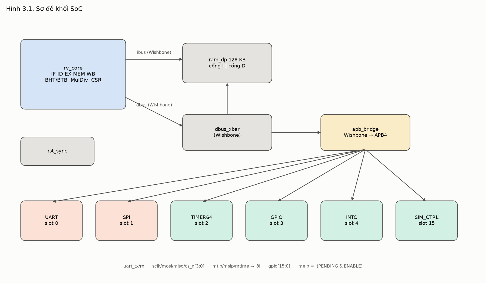
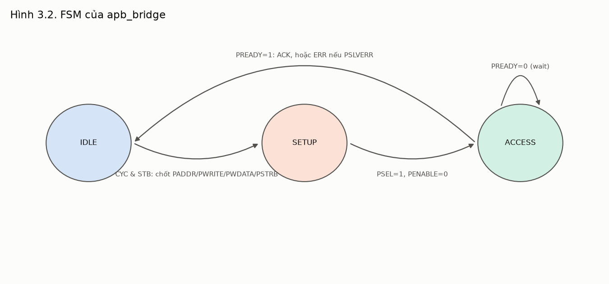
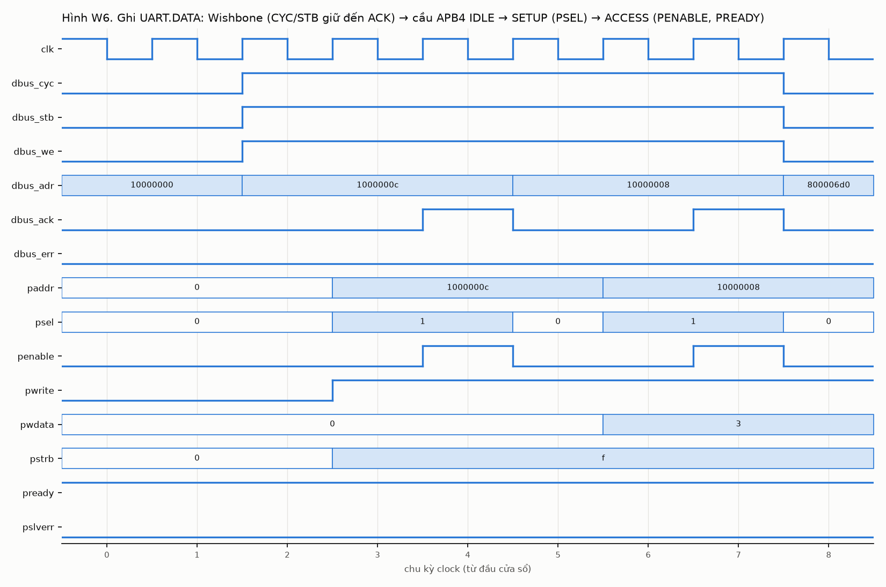
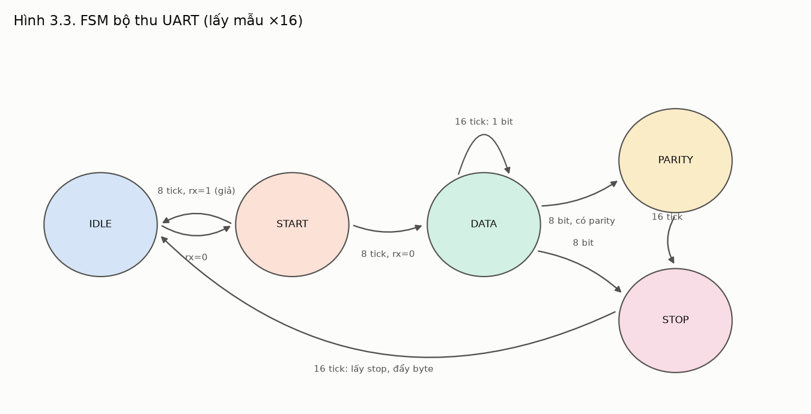
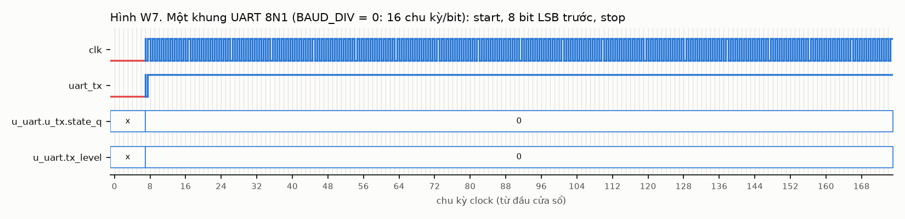
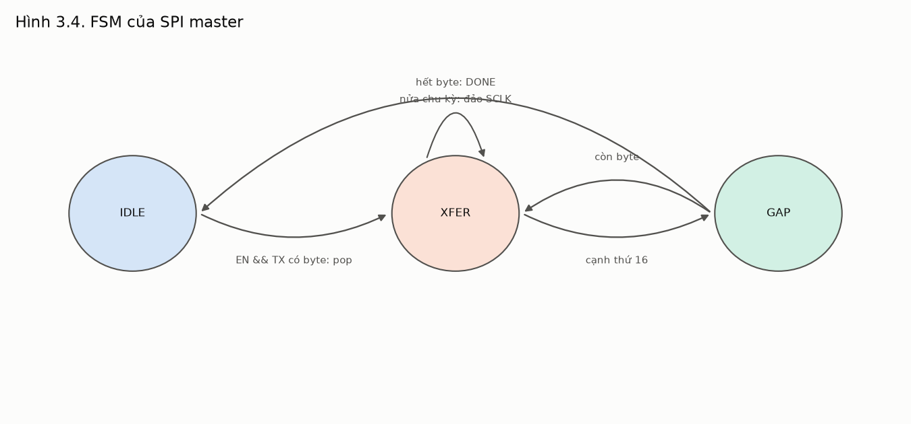
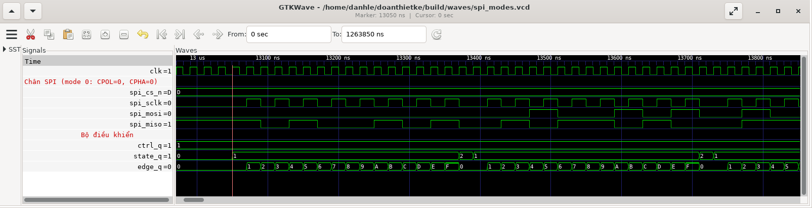
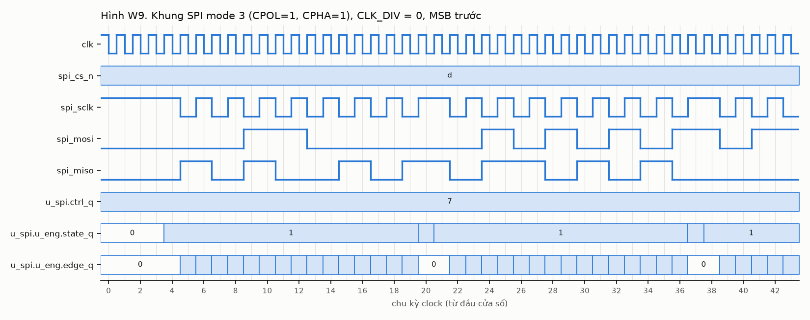

# Chương 3. Thiết kế SoC và các ngoại vi

## 3.1. Sơ đồ khối và bản đồ bộ nhớ

SoC (Hình 3.1) gồm lõi `rv_core` (hoặc `rv_core_sc` khi `CORE_SC = 1`), RAM hợp nhất `ram_dp` 128 KB hai cổng,
interconnect Wishbone `dbus_xbar`, cầu Wishbone → APB4 `apb_bridge` và sáu slave APB. Bản đồ bộ nhớ ở Bảng 3.1.

Bảng 3.1. Bản đồ bộ nhớ (nguồn: `docs/memory_map.md`).

| Vùng | Địa chỉ | Kích thước | Ghi chú |
|---|---|---|---|
| RAM | `0x8000_0000` | 128 KB | lệnh + dữ liệu; reset PC |
| UART | `0x1000_0000` | 4 KB | APB slot 0 |
| SPI | `0x1000_1000` | 4 KB | APB slot 1 |
| TIMER64 | `0x1000_2000` | 4 KB | APB slot 2 |
| GPIO | `0x1000_3000` | 4 KB | APB slot 3 |
| INTC | `0x1000_4000` | 4 KB | APB slot 4 |
| SIM_CTRL | `0x1000_F000` | 4 KB | APB slot 15, chỉ mô phỏng |
| còn lại | – | – | access fault (load 5, store 7, fetch 1) |

RAM đặt ở `0x8000_0000` để khớp mặc định của Spike và riscv-tests. Reset ngoài đi qua `rst_sync` (bật bất đồng bộ,
nhả đồng bộ qua 2 flip-flop) trước khi tới mọi khối.

## 3.2. Bus Wishbone

Lõi, RAM và bộ giải mã địa chỉ nối với nhau bằng **Wishbone B4 classic** (chuẩn bus mở của OpenCores); ngoại vi
nằm sau cầu Wishbone → **AMBA APB4**. Có bốn liên kết Wishbone: bus lệnh (lõi → cổng lệnh RAM), bus dữ liệu (lõi →
`dbus_xbar`), `dbus_xbar` → cổng dữ liệu RAM và `dbus_xbar` → `apb_bridge`.

Bảng 3.2. Tín hiệu Wishbone (phía master).

| Tín hiệu | Bus lệnh | Bus dữ liệu | Ý nghĩa |
|---|---|---|---|
| `CYC`, `STB` | = 1 sau reset | có giao dịch load/store | chu kỳ bus / yêu cầu hợp lệ |
| `ADR[31:0]` | PC (căn 2 byte) | địa chỉ byte | địa chỉ |
| `WE`, `SEL[3:0]` | – | ghi / byte enable | chiều và byte lane |
| `DAT_O`, `DAT_I` | – / lệnh 32 bit | dữ liệu ghi / đọc | dữ liệu |
| `ACK`, `ERR` | kết thúc / lỗi lấy lệnh | kết thúc / lỗi truy cập | kết thúc chu kỳ (loại trừ nhau) |

Master giữ nguyên `CYC/STB`, địa chỉ, `WE`, `SEL` và dữ liệu ghi tới khi có `ACK` hoặc `ERR`; `ERR` dẫn tới access
fault (mcause 1/5/7). Slave RAM trả `ACK` **ngay trong chu kỳ yêu cầu** (Wishbone classic cho phép), nên mọi lần lấy
lệnh và load/store vào RAM vẫn tốn đúng một chu kỳ như trước khi chuyển sang Wishbone – số chu kỳ của 9 benchmark
trùng khớp tuyệt đối trước và sau khi đổi bus. Wishbone được chọn thay vì OBI hay AXI vì hai chuẩn đó yêu cầu pha
phản hồi sớm nhất ở chu kỳ sau, buộc phải tách tầng IF và chuyển dữ liệu load về WB (quyết định D28). Khác chuẩn duy
nhất: địa chỉ bus lệnh có thể căn 2 byte và slave trả 32 bit bắt đầu từ đó. Mọi mô phỏng SoC chạy kèm bộ kiểm tra
giao thức `wb_checker` trên cả bốn liên kết (CYC/STB khi reset, ACK/ERR loại trừ nhau và chỉ khi có STB, yêu cầu giữ
nguyên tới khi kết thúc); số vi phạm phải bằng 0.

## 3.3. Bộ nhớ `ram_dp`

RAM có hai cổng slave Wishbone: cổng lệnh chỉ đọc và cổng dữ liệu ghi theo byte enable (`SEL`). Cổng lệnh trả 32 bit
bắt đầu từ địa chỉ căn 2 byte (ghép nửa trên của word kế tiếp khi `addr[1] = 1`) và trả `ERR` khi địa chỉ nằm ngoài
RAM. Mặc định RAM đọc tổ hợp: lấy được lệnh 32 bit vắt qua ranh giới word trong một chu kỳ và IF dự đoán ngay trong
chu kỳ lấy lệnh, tương ứng LUTRAM trên FPGA; cái giá là RAM nằm trên đường tổ hợp của IF và MEM. Cho FPGA có block
RAM chỉ đọc đồng bộ (M4K của Cyclone II trên board DE2), tham số `RAM_SYNC = 1` thay bằng hai bank 16 bit chạy ở cạnh
xuống của clock (bank 0 giữ nửa thấp, bank 1 nửa cao của mỗi word); địa chỉ đến từ thanh ghi nên ổn định trước cạnh
xuống và dữ liệu có trước cạnh lên kế tiếp – lõi không đổi và số chu kỳ trùng khớp tuyệt đối (quyết định D27). Trong
mô phỏng RAM được nạp bằng `$readmemh`; khi tổng hợp bằng Yosys nó là black box và không tính vào diện tích.

## 3.4. Interconnect `dbus_xbar` và cầu APB

`dbus_xbar` là bộ giải mã địa chỉ kiểu shared bus một master: địa chỉ, dữ liệu, `WE`, `SEL` được phát chung; chỉ
slave được chọn nhận `CYC/STB`, và `ACK/ERR/DAT` của nó được đưa về lõi. Vùng RAM tới cổng dữ liệu RAM, vùng
`0x1000_0000–0x1000_FFFF` tới cầu APB, địa chỉ còn lại nhận `ERR` ngay trong chu kỳ yêu cầu.

`apb_bridge` (Hình 3.2) là slave Wishbone có FSM `IDLE → SETUP → ACCESS`: khi thấy `CYC & STB`, chốt
`PADDR/PWRITE/PWDATA/PSTRB` (`PSTRB = 0` khi đọc), bật `PSEL` theo slot `addr[15:12]` ở SETUP, bật `PENABLE` ở ACCESS
và chờ `PREADY`; khi đó kết thúc chu kỳ Wishbone bằng `ACK`, hoặc `ERR` nếu `PSLVERR = 1`. Slot không có slave không
được chọn – cầu tự kết thúc bằng `ERR`, dẫn tới access fault ở lõi. Mỗi truy cập APB tốn tối thiểu 3 chu kỳ; trong
thời gian đó lõi giữ yêu cầu Wishbone và đứng ở MEM. Hình 3.3 là hai lần ghi liên tiếp vào UART lấy từ mô phỏng:
`CYC/STB` giữ suốt, mỗi lần ghi kết thúc bằng `ACK` ở pha ACCESS của APB.

Quy ước chung của các slave: thanh ghi RW ghi theo `PSTRB`; thanh ghi "push" (DATA) đẩy FIFO khi `PSTRB[0] = 1`; đọc
có side effect (pop FIFO) xảy ra đúng một lần ở chu kỳ ACCESS; offset không định nghĩa trả `PSLVERR`; không wait state.

## 3.5. FIFO đồng bộ

`sync_fifo` (tham số `WIDTH`, `DEPTH` = 16) là FIFO first-word-fall-through: `rdata` luôn là phần tử cũ nhất. Push
khi đầy bị bỏ qua (trừ khi cùng chu kỳ có pop), pop khi rỗng bị bỏ qua, cho phép push và pop đồng thời. UART và SPI mỗi
khối dùng hai FIFO (TX, RX).

## 3.6. UART

Kiến trúc: TX FIFO → `uart_tx` → chân `uart_tx`; chân `uart_rx` → đồng bộ 2 FF → `uart_rx` → RX FIFO. Khung 8 bit
dữ liệu, LSB trước, parity chẵn/lẻ tùy chọn, 1 hoặc 2 stop bit; 1 bit = 16 × (BAUD_DIV + 1) chu kỳ clock (BAUD_DIV
reset 26 ≈ 115 200 baud ở 50 MHz).

Bộ phát dùng bộ chia riêng khởi động lại ở đầu khung để độ dài bit chính xác. Bộ thu (Hình 3.4) phát hiện cạnh xuống,
khởi động lại bộ chia, kiểm tra lại start bit sau 8 tick (lọc xung nhiễu ngắn hơn nửa bit), rồi lấy mẫu mỗi 16 tick
– tức ở giữa mỗi bit. Byte được đẩy vào RX FIFO khi lấy mẫu stop bit; stop bit bằng 0 là frame error, parity sai là
parity error, FIFO đầy là overrun (byte bị bỏ).

Bảng 3.3. Thanh ghi UART (nguồn: `docs/register_map.md`).

| Off | Tên | Mô tả |
|---|---|---|
| 0x00 | DATA | W: đẩy TX FIFO; R: byte RX, bit 31 = RX rỗng, pop |
| 0x04 | STATUS | TX_FULL/EMPTY/IDLE, RX_EMPTY/FULL, OVERRUN, FRAME_ERR, PARITY_ERR, TX_LEVEL, RX_LEVEL |
| 0x08 | CTRL | TX_EN, RX_EN, PARITY_EN, PARITY_ODD, STOP2 |
| 0x0C | BAUD_DIV | hệ số chia |
| 0x10 | IRQ_EN | TX_WM, RX_WM, ERR |
| 0x14 | IRQ_STATUS | TX_WM (TX_LEVEL ≤ ngưỡng), RX_WM (RX_LEVEL ≥ ngưỡng) theo mức; ERR dính, W1C |
| 0x18 | WATERMARK | TX_WM_LVL, RX_WM_LVL |

Ngắt theo mức (`irq = |(IRQ_STATUS & IRQ_EN)`) giúp trình xử lý đơn giản: đọc tới khi RX FIFO rỗng thì nguồn tự hết.
Hình 3.5 là một khung UART 8N1 trích từ mô phỏng.

## 3.7. SPI master

SPI master full-duplex 8 bit/khung, đủ 4 mode (CPOL, CPHA), MSB hoặc LSB trước, CS điều khiển bằng phần mềm, tần số
`f_SCLK = f_clk / (2 × (CLK_DIV + 1))`.

FSM (Hình 3.6): ở IDLE, khi được bật và TX FIFO có byte thì lấy byte, chuyển XFER (với CPHA = 0 đặt bit đầu lên MOSI
ngay). Trong XFER, mỗi nửa chu kỳ SCLK đảo một lần; cạnh chẵn là leading, cạnh lẻ là trailing; tùy CPHA, MISO được lấy
mẫu ở leading hoặc trailing và MOSI đổi ở cạnh còn lại. Sau cạnh thứ 16, thêm một nửa chu kỳ GAP rồi giao byte nhận cho
RX FIFO và bắt đầu byte kế (nếu còn). LSB-first được hiện thực bằng đảo bit ở đầu vào và đầu ra của bộ dịch.

Bảng 3.4. Thanh ghi SPI.

| Off | Tên | Mô tả |
|---|---|---|
| 0x00 | DATA | W: đẩy TX FIFO; R: byte RX, bit 31 = RX rỗng, pop |
| 0x04 | STATUS | TX_FULL/EMPTY, RX_EMPTY/FULL, BUSY, RX_OVERRUN, mức FIFO |
| 0x08 | CTRL | EN, CPOL, CPHA, LSB_FIRST |
| 0x0C | CLK_DIV | hệ số chia SCLK |
| 0x10 | CS | CS_N[3:0] |
| 0x14 | IRQ_EN | TX_EMPTY, RX_NOT_EMPTY, DONE, OVERRUN |
| 0x18 | IRQ_STATUS | hai bit mức; DONE (byte cuối xong, TX FIFO rỗng) và OVERRUN dính, W1C |

Ngắt DONE cho phép firmware nạp tối đa 16 byte rồi ngủ (`wfi`) tới khi truyền xong. Hình 3.7 và 3.8 là khung SPI ở
mode 0 và mode 3 trích từ mô phỏng system test `spi_modes`.

## 3.8. TIMER64, GPIO và INTC

**TIMER64** (`0x1000_2000`): `mtime` 64 bit tăng sau mỗi `PRESCALE + 1` chu kỳ, `mtimecmp` (reset toàn bit 1),
`mtip = mtime ≥ mtimecmp` theo mức, `msip` từ thanh ghi MSIP. Giá trị `mtime` nối thẳng vào lõi cho CSR `time`.
Firmware đọc 64 bit bằng vòng hi–lo–hi và ghi `mtimecmp` theo trình tự của Privileged spec (LO = 0xFFFF_FFFF, HI,
LO) để không tạo ngắt giả. Không có mã IP từ Đồ án cơ sở 4 trong thư mục `ip/`, nên khối được hiện thực mới theo đặc
tả.

**GPIO** (`0x1000_3000`): 16 chân, OUT, DIR (điều khiển `gpio_oe`, tri-state nằm ngoài `soc_top`), IN đồng bộ 2 FF,
ngắt cạnh lên/xuống theo từng chân với cờ dính W1C.

**INTC** (`0x1000_4000`): PENDING (mức của UART, SPI, GPIO), ENABLE, ACTIVE; `meip = |(PENDING & ENABLE)`. Trình xử
lý ngắt ngoài đọc ACTIVE và gọi handler từng ngoại vi; mọi nguồn theo mức nên không mất ngắt khi nhiều nguồn cùng bật.

**SIM_CTRL** (`0x1000_F000`, chỉ mô phỏng): in ký tự và kết thúc mô phỏng với mã thoát.

Bảng 3.5. Thanh ghi TIMER64, GPIO, INTC (nguồn: `docs/register_map.md`).

| Khối | Off | Tên | Mô tả |
|---|---|---|---|
| TIMER64 | 0x00/0x04 | MTIME_LO/HI | bộ đếm 64 bit (RW) |
| TIMER64 | 0x08/0x0C | MTIMECMP_LO/HI | ngưỡng so sánh (reset toàn 1) |
| TIMER64 | 0x10 | CTRL | EN, PRESCALE[15:8] |
| TIMER64 | 0x14 | MSIP | bit 0 → ngắt phần mềm |
| GPIO | 0x00/0x04/0x08 | OUT / IN / DIR | xuất, nhập (đồng bộ 2 FF), hướng |
| GPIO | 0x0C/0x10/0x14 | IRQ_EN / IRQ_STATUS / IRQ_TYPE | ngắt cạnh theo chân, W1C, lên/xuống |
| INTC | 0x00/0x04/0x08 | PENDING / ENABLE / ACTIVE | mức nguồn, cho phép, nguồn đang hoạt động |

## 3.9. Kịch bản sử dụng flash SPI

Driver `spi_flash.c` hiện thực các lệnh W25Q trên CS0. Ghi một trang tuân theo trình tự của datasheet:

1. `WREN` (0x06) – đặt bit WEL;
2. `SECTOR ERASE` (0x20 + địa chỉ 24 bit) – flash bận (WIP = 1) trong thời gian xóa;
3. đọc `RDSR` (0x05) lặp tới khi WIP = 0;
4. `WREN`, rồi `PAGE PROGRAM` (0x02 + địa chỉ + tối đa 256 byte); chờ WIP;
5. `READ` (0x03 + địa chỉ) để đọc lại và so sánh.

Các pha dữ liệu dài được truyền theo khối 16 byte bằng ngắt DONE: CPU nạp FIFO, ngủ bằng `wfi`, được đánh thức khi byte
cuối truyền xong rồi đọc RX FIFO. System test `spi_flash` kiểm tra toàn bộ trình tự này (kể cả việc PAGE PROGRAM không có
WREN bị flash bỏ qua) và JEDEC ID ở cả mode 0 và mode 3.

## 3.10. Phần mềm

Phần mềm nền (`sw/common`) gồm `crt0` (stack, `gp`, xóa `.bss`, `mtvec`), trình vào/ra trap lưu thanh ghi caller-saved
và gọi `trap_handler(mcause, mepc, mtval)`, bảng vector cho chế độ vectored, `printf` tối giản, các hàm `mem*/str*`,
đọc counter 64 bit. Driver (`sw/drivers`) cho UART, SPI, flash SPI, TIMER, GPIO, INTC đều có API polling và API dùng
ngắt. `exit(code)` ghi SIM_CTRL rồi `tohost`, nên cùng một ELF chạy được trên RTL và trên Spike. Phần mềm được build
theo ba biến thể `rv32i`, `rv32im`, `rv32imc` vì assembler tự nén lệnh khi `-march` có `c`.

Bảng 3.6. API driver chính (nguồn: `sw/drivers/*.h`).

| Driver | Polling | Dùng ngắt |
|---|---|---|
| UART | `uart_putc`, `uart_getc`, `uart_flush` | `uart_rx_irq_start`, `uart_isr` (ring buffer), `uart_rx_read` |
| SPI | `spi_xfer`, `spi_xfer_buf` | `spi_irq_mode`, `spi_xfer_buf_irq` (DONE + `wfi`), `spi_isr` |
| Flash | `flash_read_id`, `flash_read`, `flash_page_program`, `flash_sector_erase`, `flash_wait_busy` | `flash_use_irq = 1` |
| TIMER | `timer_mtime` (hi–lo–hi), `timer_set_cmp` (trình tự an toàn) | `timer_irq_enable`, `irq_timer_handler` |
| GPIO | `gpio_write`, `gpio_read`, `gpio_set_dir` | `gpio_irq_config`, `gpio_isr` |
| INTC | `intc_enable`, `intc_active` | `irq_external_handler` (phân phối tới các ISR) |

## 3.11. Chương trình demo

`sw/tests/demo` minh họa toàn bộ SoC ở tốc độ UART thật (115 200 baud): ngắt timer mỗi 10 ms đọc 16 byte từ flash SPI
và in dạng hex; sau đó ngắt RX UART nhận lệnh từng dòng: `r` đọc 16 byte tại `0x001000`, `w` xóa sector và ghi chuỗi
"RISC-V SoC DEMO!", `s` in các bộ đếm hiệu năng, `q` kết thúc. Testbench gửi chuỗi lệnh `r, w, r, s, q` sau mỗi dấu nhắc
`>` và so sánh toàn bộ output với file kỳ vọng (các con số phụ thuộc thời gian được so bằng ký tự đại diện).
Output thật của demo nằm ở `build/logs/systest/m1c1_bp2/demo.uart.txt` sau khi chạy `make systest`.
