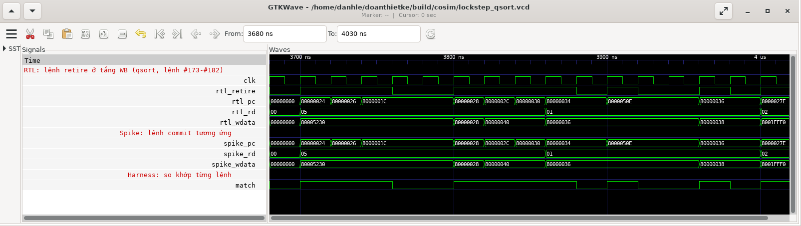

# Chương 4. Xác minh và đánh giá

Mọi bảng trong chương này được trích từ các file trong `results/` (ghi ở chú thích bảng) và được sinh lại bằng `scripts/make_chapter4.py`; lệnh tái tạo số liệu ghi trong `docs/giai_thich/huong_dan_chay.md`.

## 4.1. Môi trường xác minh ba mức

1. **Mức khối** – 14 testbench SystemVerilog tự kiểm tra (Verilator `--binary --timing`), mỗi testbench có mô hình tham chiếu, test có hướng với giá trị biên và test ngẫu nhiên có seed (`+seed=`). Bộ giải nén C được so với bảng kỳ vọng do chính GNU assembler sinh (`.option rvc` / `.option norvc`). Interconnect Wishbone và cầu Wishbone → APB4 được kiểm bằng truy cập ngẫu nhiên kèm bộ kiểm tra giao thức `wb_checker`.
2. **Mức lõi** – bộ riscv-tests chính thức, chạy với môi trường riêng chỉ có Machine mode, trên ma trận cấu hình RTL × biến thể ELF; commit log của RTL được so khớp từng lệnh với mô hình tham chiếu Spike.
3. **Mức hệ thống** – firmware C chạy trên `tb_soc` cùng các BFM: UART (giải mã TX, gửi RX), flash SPI kiểu W25Q (CS0), SPI slave đủ 4 mode (CS1), kích thích GPIO. Tiêu chí PASS: mã thoát 0, output UART khớp file kỳ vọng, BFM không phát hiện lỗi, và 0 vi phạm giao thức Wishbone trên bốn liên kết bus (ibus, dbus, cổng dữ liệu RAM, cầu APB) – `wb_checker` chạy trong mọi mô phỏng `tb_soc`.

Bảng 4.1. Kết quả unit testbench (nguồn: `results/unit/summary.md`).

| Testbench             | Kết quả | Seed | Thời gian (s) | Ghi chú      |
| --------------------- | ------- | ---- | ------------- | ------------ |
| tb_alu                | PASS    |    1 |           0.0 | 15440 checks |
| tb_regfile            | PASS    |    1 |           0.0 | 40134 checks |
| tb_muldiv             | PASS    |    1 |           0.1 | 4316 checks  |
| tb_compressed_decoder | PASS    |    1 |           0.1 | 2104 checks  |
| tb_bp                 | PASS    |    1 |           0.0 | 6304 checks  |
| tb_csr                | PASS    |    1 |           0.0 | 136 checks   |
| tb_fifo               | PASS    |    1 |           0.0 | 77335 checks |
| tb_apb_bridge         | PASS    |    1 |           0.0 | 3038 checks  |
| tb_dbus_xbar          | PASS    |    1 |           0.0 | 5815 checks  |
| tb_uart               | PASS    |    1 |           0.1 | 549 checks   |
| tb_spi                | PASS    |    1 |           0.0 | 395 checks   |
| tb_timer              | PASS    |    1 |           0.0 | 220 checks   |
| tb_gpio               | PASS    |    1 |           0.0 | 617 checks   |
| tb_intc               | PASS    |    1 |           0.0 | 2209 checks  |

## 4.2. riscv-tests

Tổng cộng 415 lượt test PASS, 0 FAIL trên 7 cấu hình (Bảng 4.2; `m1c1_bp2_sync` là cấu hình RAM đồng bộ 32 KB dùng cho board DE2). Ba test được loại trừ có lý do: `rv32ui-p-ma_data` (lõi trap khi truy cập không căn lề – hợp lệ theo đặc tả, hành vi trap được kiểm bởi `rv32mi-p-ma_addr`), `rv32mi-p-breakpoint` (cần CSR debug trigger, dòng 33 `csrw tselect, x0`) và `rv32mi-p-pmpaddr` (cần PMP, dòng 27 `csrw pmpcfg0, zero`).

Bảng 4.2. riscv-tests theo cấu hình (nguồn: `results/isa/summary.md`).

| Cấu hình RTL    | ELF   | Bộ test                     | PASS | FAIL | EXCLUDED |
| --------------- | ----- | --------------------------- | ---- | ---- | -------- |
| `m1c1_bp0`      | `imc` | rv32ui,rv32um,rv32uc,rv32mi |   64 |    0 |        3 |
| `m1c1_bp1`      | `imc` | rv32ui,rv32um,rv32uc,rv32mi |   64 |    0 |        3 |
| `m1c1_bp2`      | `imc` | rv32ui,rv32um,rv32uc,rv32mi |   64 |    0 |        3 |
| `m1c0_bp2`      | `im`  | rv32ui,rv32um,rv32mi        |   63 |    0 |        3 |
| `m0c0_bp2`      | `i`   | rv32ui,rv32mi               |   55 |    0 |        3 |
| `sc`            | `i`   | rv32ui                      |   41 |    0 |        1 |
| `m1c1_bp2_sync` | `imc` | rv32ui,rv32um,rv32uc,rv32mi |   64 |    0 |        3 |

## 4.3. So sánh với Spike

Lõi in commit log tại WB theo định dạng `spike --log-commits`; script `compare_spike.py` so khớp từng lệnh (PC, mã lệnh, thanh ghi đích và giá trị, địa chỉ và dữ liệu store). Giá trị đọc từ các bộ đếm phụ thuộc thời gian được đánh dấu "taint" và theo dõi qua thanh ghi và bộ nhớ; khi luồng lệnh rẽ khác ngay sau một nhánh phụ thuộc giá trị đó (in số chu kỳ), so sánh dừng lock-step và chỉ so mã thoát. Khác biệt tùy hiện thực được liệt kê: `marchid` (RTL 0, Spike 5) và `misa` (Spike cho phép xóa bit C, lõi này không – test `rv32mi-p-ma_fetch` rẽ nhánh khác sau đó).

Bảng 4.3. Kết quả so sánh (nguồn: `results/spike/summary.md`; chi tiết từng chương trình trong `results/spike/<cấu hình>.md`).

| Cấu hình   | MATCH | Tổng |
| ---------- | ----- | ---- |
| `m1c1_bp2` |    73 |   73 |
| `m1c0_bp2` |    72 |   72 |
| `m0c0_bp2` |    64 |   64 |
| `sc`       |    50 |   50 |

Cùng phép so sánh này còn được làm **trong lúc chạy** bằng harness C++ (co-simulation lock-step, mục 4.9).

## 4.4. System test

Bảng 4.4. System test (nguồn: `results/systest/summary.md`).

| Test           | Cấu hình RTL | Kết quả | Chu kỳ  | Ghi chú                                          |
| -------------- | ------------ | ------- | ------- | ------------------------------------------------ |
| hello          | `m1c1_bp2`   | PASS    |   12135 |                                                  |
| uart_irq_echo  | `m1c1_bp2`   | PASS    |   44819 | RESULT uart_irq_echo: PASS (79 checks, 0 errors) |
| spi_flash      | `m1c1_bp2`   | PASS    |   71663 | RESULT spi_flash: PASS (281 checks, 0 errors)    |
| spi_modes      | `m1c1_bp2`   | PASS    |   63188 | RESULT spi_modes: PASS (16 checks, 0 errors)     |
| timer_irq      | `m1c1_bp2`   | PASS    |   40534 | RESULT timer_irq: PASS (23 checks, 0 errors)     |
| timer_irq      | `sc`         | PASS    |   40355 | RESULT timer_irq: PASS (23 checks, 0 errors)     |
| gpio_irq       | `m1c1_bp2`   | PASS    |   15795 | RESULT gpio_irq: PASS (11 checks, 0 errors)      |
| irq_priority   | `m1c1_bp2`   | PASS    |   21746 | RESULT irq_priority: PASS (8 checks, 0 errors)   |
| irq_priority   | `sc`         | PASS    |   21546 | RESULT irq_priority: PASS (8 checks, 0 errors)   |
| exceptions     | `m1c1_bp2`   | PASS    |  129554 | RESULT exceptions: PASS (62 checks, 0 errors)    |
| exceptions     | `m1c0_bp2`   | PASS    |  132125 | RESULT exceptions: PASS (66 checks, 0 errors)    |
| exceptions     | `sc`         | PASS    |  132102 | RESULT exceptions: PASS (66 checks, 0 errors)    |
| irq_during_div | `m1c1_bp2`   | PASS    |  494430 | RESULT irq_during_div: PASS (3 checks, 0 errors) |
| demo           | `m1c1_bp2`   | PASS    | 4088021 |                                                  |
| branch_smc     | `m1c1_bp2`   | PASS    |   24718 | RESULT branch_smc: PASS (4 checks, 0 errors)     |
| branch_smc     | `m1c1_bp0`   | PASS    |   24775 | RESULT branch_smc: PASS (4 checks, 0 errors)     |
| branch_smc     | `sc`         | PASS    |   24691 | RESULT branch_smc: PASS (4 checks, 0 errors)     |
| muldiv_rand    | `m1c1_bp2`   | PASS    | 6031222 | RESULT muldiv_rand: PASS (9 checks, 0 errors)    |
| muldiv_rand    | `m1c0_bp2`   | PASS    | 6040505 | RESULT muldiv_rand: PASS (9 checks, 0 errors)    |

## 4.5. Waveform minh họa

Các hình là ảnh chụp cửa sổ GTKWave mở file VCD của mô phỏng RTL (`scripts/make_waves.py` tìm khung thời gian của từng sự kiện, đặt marker đỏ tại sự kiện rồi chụp màn hình; GTKWave chạy trên màn hình ảo Xvfb). Cột trái là tên tín hiệu và giá trị tại marker.


Các hình giao dịch Wishbone → APB4, khung UART và khung SPI mode 0/3 được trình bày ở Chương 3 (Hình 3.3, 3.5, 3.7, 3.8). Bảng diễn biến pipeline theo từng chu kỳ của đoạn chương trình minh họa: `results/waves/walkthrough_table.md` và phần giải thích trong `docs/giai_thich/walkthrough_pipeline.md`.

## 4.6. Coverage

Bảng 4.5. Line và toggle coverage theo thư mục (nguồn: `results/coverage/summary.md`; các dòng chưa phủ được liệt kê trong `results/coverage/uncovered.md`).

| Thư mục    | Line            | Toggle           |
| ---------- | --------------- | ---------------- |
| rtl (khác) | 100.0% (98/98)  | 97.9% (183/187)  |
| rtl/core   | 99.8% (592/593) | 100.0% (478/478) |
| rtl/periph | 97.5% (119/122) | 98.6% (212/215)  |

Functional coverage: 71/71 điểm `cover property` đạt (`results/coverage/functional.md`), gồm mọi nhóm lệnh, 8 lệnh M, lệnh nén, 4 đường forward, các loại stall, sai dự đoán theo loại, mọi mcause, ngắt khi bộ chia đang chạy, trap ngay sau nhánh sai, lệnh 32 bit vắt qua ranh giới word, 4 mode SPI, định dạng UART và trạng thái đầy/rỗng của các FIFO.

## 4.7. Hiệu năng

Mọi benchmark đo trong vùng đo (giữa hai lần gọi `setStats`/`start_time`) bằng `mcycle`, `minstret` và `mhpmcounter3..10`.

### 4.7.1. Bộ dự đoán rẽ nhánh

Geomean CPI trên 9 benchmark giảm từ 1.320 (BP_MODE 0) xuống 1.223 (BP_MODE 1) và 1.097 (BP_MODE 2). Dhrystone: 1.435 → 1.307 → 1.204. CoreMark: 2.43 → 2.62 → 2.88 CoreMark/MHz (2 iteration). Kiểm tra hợp lý của đặc tả (CPI Dhrystone trong [1,0; 2,0] và BP_MODE 2 không tệ hơn BP_MODE 0) đều đạt.

Bảng 4.6. CPI, độ chính xác, penalty (nguồn: `results/perf/exp1_predictor.csv`).

| Benchmark       | CPI BP0 | CPI BP1 | CPI BP2 | Acc BP0 | Acc BP1 | Acc BP2 | Penalty BP0 | Penalty BP1 | Penalty BP2 |
| --------------- | ------- | ------- | ------- | ------- | ------- | ------- | ----------- | ----------- | ----------- |
| dhrystone       |   1.435 |   1.307 |   1.204 |   24.2% |   85.0% |   83.3% |       98704 |       60615 |       27516 |
| coremark        |   1.314 |   1.220 |   1.110 |   39.8% |   89.5% |   90.2% |      165288 |      108586 |       29885 |
| median          |   1.396 |   1.375 |   1.255 |   43.1% |   63.6% |   63.6% |        5276 |        4725 |        2414 |
| multiply        |   1.585 |   1.350 |   1.063 |    8.9% |   88.7% |   90.2% |       26096 |       16508 |        2884 |
| qsort           |   1.399 |   1.341 |   1.199 |   42.3% |   74.5% |   74.5% |       90000 |       68981 |       23089 |
| rsort           |   1.066 |   1.033 |   1.000 |    0.7% |   99.7% |   99.6% |       32226 |       16377 |         353 |
| towers          |   1.119 |   1.099 |   1.067 |   26.6% |   64.0% |   65.1% |        2412 |        1656 |         678 |
| vvadd           |   1.250 |   1.129 |   1.008 |    3.5% |   98.7% |   98.7% |        2984 |        1645 |         246 |
| memcpy          |   1.399 |   1.200 |   1.001 |    0.4% |   99.9% |   99.9% |       21508 |       10905 |         250 |
| **geomean CPI** |   1.320 |   1.223 |   1.097 |         |         |         |             |             |             |


### 4.7.2. Kích thước BHT và BTB

Bảng 4.7. Độ chính xác trung bình / geomean CPI / diện tích theo BHT × BTB (nguồn: `results/perf/exp2_sweep.csv`, `results/synth/summary.json`).

| BHT \ BTB | 8                          | 16                         | 32                         | 64                         |
| --------- | -------------------------- | -------------------------- | -------------------------- | -------------------------- |
|        16 | 82.0% / 1.116 / 26427 cell | 83.7% / 1.106 / 27412 cell | 84.7% / 1.099 / 29403 cell | 85.2% / 1.096 / 33277 cell |
|        64 | 82.1% / 1.115 / 27170 cell | 84.0% / 1.104 / 28112 cell | 85.0% / 1.097 / 30096 cell | 85.6% / 1.093 / 33915 cell |
|       256 | 82.1% / 1.115 / 29826 cell | 83.9% / 1.104 / 30811 cell | 85.0% / 1.097 / 32801 cell | 85.5% / 1.093 / 36664 cell |
|      1024 | 82.1% / 1.115 / 40870 cell | 83.9% / 1.104 / 41837 cell | 85.0% / 1.097 / 43817 cell | 85.6% / 1.093 / 47690 cell |

Độ chính xác chủ yếu phụ thuộc kích thước BTB (82.1% với 8 entry lên 85.5% với 64 entry, BHT 256), còn BHT lớn hơn 64 entry gần như không cải thiện (85.0% so với 85.0% ở BTB 32) vì các benchmark có ít nhánh nóng; trong khi đó diện tích tăng mạnh theo BHT (30096 → 43817 cell) vì bảng làm bằng flip-flop. Điểm cân bằng hợp lý cho các tải này là BHT 64 × BTB 32.


### 4.7.3. Extension C

Tổng kích thước `.text` của 9 benchmark giảm từ 53388 xuống 40676 byte (23.8%), trong khi CPI gần như không đổi.

Bảng 4.8. Kích thước mã và CPI (nguồn: `results/perf/exp3_rvc.csv`).

| Benchmark | .text im | .text imc | Giảm  | Lệnh nén (%) | Chu kỳ im | Chu kỳ imc | CPI im | CPI imc |
| --------- | -------- | --------- | ----- | ------------ | --------- | ---------- | ------ | ------- |
| dhrystone |     7068 |      5488 | 22.4% |        54.5% |    338104 |     333617 |  1.220 |   1.204 |
| coremark  |    12404 |      8992 | 27.5% |        54.8% |    702058 |     695588 |  1.120 |   1.110 |
| median    |     4496 |      3504 | 22.1% |        64.7% |      5402 |       5404 |  1.254 |   1.255 |
| multiply  |     4508 |      3520 | 21.9% |        83.1% |     22282 |      22282 |  1.063 |   1.063 |
| qsort     |     4796 |      3716 | 22.5% |        42.9% |    148615 |     148150 |  1.203 |   1.199 |
| rsort     |     5328 |      4140 | 22.3% |        47.3% |    171250 |     171242 |  1.000 |   1.000 |
| towers    |     5812 |      4332 | 25.5% |        66.1% |      4037 |       4028 |  1.069 |   1.067 |
| vvadd     |     4440 |      3468 | 21.9% |        74.1% |      2489 |       2489 |  1.008 |   1.008 |
| memcpy    |     4536 |      3516 | 22.5% |        40.0% |     20110 |      20110 |  1.001 |   1.001 |
| **tổng**  |    53388 |     40676 | 23.8% |              |           |            |        |         |


### 4.7.4. Phân rã CPI

Bảng 4.9. Phân rã CPI ở BP_MODE 2 (nguồn: `results/perf/exp4_cpi_breakdown.csv`).

| Benchmark | CPI   | load-use | MulDiv | bus   | mispredict | other |
| --------- | ----- | -------- | ------ | ----- | ---------- | ----- |
| dhrystone | 1.204 |    0.047 |  0.059 | 0.000 |      0.072 | 0.025 |
| coremark  | 1.110 |    0.065 |  0.000 | 0.000 |      0.041 | 0.004 |
| median    | 1.255 |    0.002 |  0.000 | 0.000 |      0.252 | 0.001 |
| multiply  | 1.063 |    0.001 |  0.000 | 0.000 |      0.063 | 0.000 |
| qsort     | 1.199 |    0.036 |  0.000 | 0.000 |      0.161 | 0.003 |
| rsort     | 1.000 |    0.000 |  0.000 | 0.000 |      0.000 | 0.000 |
| towers    | 1.067 |    0.012 |  0.000 | 0.000 |      0.051 | 0.004 |
| vvadd     | 1.008 |    0.004 |  0.000 | 0.000 |      0.003 | 0.001 |
| memcpy    | 1.001 |    0.001 |  0.000 | 0.000 |      0.000 | 0.000 |


Sai dự đoán là nguồn mất chu kỳ lớn nhất ở các benchmark có nhánh phụ thuộc dữ liệu (median, qsort); load-use đáng kể ở CoreMark và Dhrystone; stall MulDiv chỉ xuất hiện ở Dhrystone (một phép chia mỗi vòng); các benchmark không truy cập ngoại vi trong vùng đo nên không có chờ bus.

### 4.7.5. Single-cycle so với pipeline

Bảng 4.10. CPI, Fmax và hiệu năng tương đối (nguồn: `results/perf/exp5_sc_vs_pipeline.csv`).

| Lõi                              | geomean CPI | Dhrystone CPI | Fmax (MHz) | Fmax/CPI | Hiệu năng tương đối |
| -------------------------------- | ----------- | ------------- | ---------- | -------- | ------------------- |
| rv_core_sc (single-cycle, RV32I) |       1.000 |         1.000 |      25.67 |     25.7 |               1.00× |
| rv_core pipeline RV32I           |       1.104 |         1.178 |      43.67 |     39.6 |               1.54× |
| rv_core pipeline RV32IMC         |       1.097 |         1.204 |      43.73 |     39.9 |               1.55× |


Pipeline có CPI lớn hơn 1 một chút nhưng tần số SoC cao hơn nhiều so với single-cycle (đường tổ hợp của single-cycle đi qua RAM hai lần), nên hiệu năng (∝ Fmax/CPI) cao hơn rõ rệt; phiên bản RV32I có Fmax cao hơn RV32IMC vì không có bộ nhân nằm trên đường găng.

## 4.8. Diện tích, Fmax và đường găng

Diện tích tính bằng số cell sau Yosys `synth -flatten` (thư viện generic), **không gồm RAM 128 KB** (black box). Fmax là ước lượng trên FPGA Lattice ECP5 (nextpnr): mỗi thiết kế được đặt–định tuyến với 5 seed trên cùng netlist, báo trung vị và khoảng min–max, vì một seed riêng lẻ có thể lệch vài chục phần trăm chỉ do thay đổi rất nhỏ của netlist. Place & route ASIC (sky130, chỉ lõi): mục 4.11.

Bảng 4.11. Diện tích (nguồn: `results/synth/area.csv`).

| Khối               | Tham số                                      | Cell  | Flip-flop |
| ------------------ | -------------------------------------------- | ----- | --------- |
| `rv_core_m1c1_bp0` | {'ENABLE_M': 1, 'ENABLE_C': 1, 'BP_MODE': 0} | 24567 |      2532 |
| `rv_core_m1c1_bp1` | {'ENABLE_M': 1, 'ENABLE_C': 1, 'BP_MODE': 1} | 28970 |      3045 |
| `rv_core_m1c1_bp2` | {'ENABLE_M': 1, 'ENABLE_C': 1, 'BP_MODE': 2} | 32801 |      4966 |
| `rv_core_m1c0_bp2` | {'ENABLE_M': 1, 'ENABLE_C': 0, 'BP_MODE': 2} | 30995 |      4871 |
| `rv_core_m0c0_bp2` | {'ENABLE_M': 0, 'ENABLE_C': 0, 'BP_MODE': 2} | 21370 |      4699 |
| `rv_core_sc`       | –                                            | 10477 |      1509 |
| `uart_apb`         | –                                            |  1457 |       411 |
| `spi_apb`          | –                                            |  1145 |       364 |
| `timer64_apb`      | –                                            |  1245 |       146 |
| `gpio_apb`         | –                                            |   611 |       130 |
| `intc_apb`         | –                                            |    54 |         3 |
| `apb_bridge`       | –                                            |   182 |        71 |
| `dbus_xbar`        | –                                            |   173 |         0 |
| `sim_ctrl`         | –                                            |    18 |         0 |
| `rst_sync`         | –                                            |     2 |         2 |
| `soc_top`          | –                                            | 37785 |      6077 |

Bảng 4.12. Tài nguyên ECP5 và Fmax (nguồn: `results/synth/summary.md`).

| Thiết kế          | LUT4  | FF   | Fmax trung vị (MHz) | min – max (5 seed) | Đường găng (seed trung vị, tóm tắt)                                                    |
| ----------------- | ----- | ---- | ------------------- | ------------------ | -------------------------------------------------------------------------------------- |
| `m1c1_bp2`        |  9715 | 4966 |               40.68 | 40.23 – 42.55      | `u_id.ex_is_load` → `u_ex.fwd_rs1` (49 chặng logic/định tuyến)                         |
| `m1c1_bp0`        |  5493 | 2532 |               43.45 | 41.73 – 46.99      | `u_ex.mem_rd_we` → `dbus_adr_o` (27 chặng logic/định tuyến)                            |
| `m0c0_bp2`        |  8446 | 4699 |               45.48 | 43.7 – 46.64       | `u_ex.mem_rd_we` → `u_if.pc_q` (46 chặng logic/định tuyến)                             |
| `sc`              |  4501 | 1509 |               46.22 | 44.09 – 47.74      | `u_csr.wdata` → `u_csr.wdata` (42 chặng logic/định tuyến)                              |
| `soc_top_1k`      | 11663 | 5565 |               43.73 | 42.02 – 44.79      | `g_pipe.u_core.u_ex.mem_rd_we` → `g_pipe.u_core.u_if.pc_q` (22 chặng logic/định tuyến) |
| `soc_top_m0c0_1k` | 10211 | 5298 |               43.67 | 39.74 – 46.95      | `g_pipe.u_core.u_ex.mem_rd` → `g_pipe.u_core.u_if.id_insn` (33 chặng logic/định tuyến) |
| `soc_top_sc_1k`   |  8281 | 2108 |               25.67 | 24.97 – 26.11      | `g_sc.u_core.pc_q` → `g_sc.u_core.irq_mtip` (41 chặng logic/định tuyến)                |

Đường găng của lõi `m1c1_bp2` (seed trung vị, 40.68 MHz) gồm các chặng sau (trích `results/synth/critical_path_m1c1_bp2.txt`, chỉ giữ tên nguồn/đích):

```
Source u_id.ex_is_load_TRELLIS_FF_DI_Q_TRELLIS_FF_Q.Q
Sink   u_ex.mem_rd_we_LUT4_B.D
Source u_ex.mem_rd_we_LUT4_B.F
Sink   u_ex.mem_rd_we_LUT4_B_Z_PFUMX_C0_1_ALUT_LUT4_Z.M
Source u_ex.mem_rd_we_LUT4_B_Z_PFUMX_C0_1_ALUT_LUT4_Z.OFX
Sink   u_ex.fwd_rs1_L6MUX21_Z_2_D1_L6MUX21_Z_D0_PFUMX_Z_ALUT_LUT4_Z.M
Source u_ex.fwd_rs1_L6MUX21_Z_2_D1_L6MUX21_Z_D0_PFUMX_Z_ALUT_LUT4_Z.OFX
Sink   u_ex.fwd_rs2_PFUMX_Z_BLUT_LUT4_Z_B_LUT4_B_Z_PFUMX_BLUT_Z_CCU2C_B0_S0_LUT4_D_Z_LUT4_Z_B_PFUMX_C0_Z_LU
Source u_ex.fwd_rs2_PFUMX_Z_BLUT_LUT4_Z_B_LUT4_B_Z_PFUMX_BLUT_Z_CCU2C_B0_S0_LUT4_D_Z_LUT4_Z_B_PFUMX_C0_Z_LU
Sink   u_ex.fwd_rs2_PFUMX_Z_BLUT_LUT4_Z_B_LUT4_B_Z_PFUMX_BLUT_Z_CCU2C_B0_S0_LUT4_D_Z_LUT4_Z_B_PFUMX_C0_Z_LU
Source u_ex.fwd_rs2_PFUMX_Z_BLUT_LUT4_Z_B_LUT4_B_Z_PFUMX_BLUT_Z_CCU2C_B0_S0_LUT4_D_Z_LUT4_Z_B_PFUMX_C0_Z_LU
Sink   u_ex.fwd_rs2_PFUMX_Z_BLUT_LUT4_Z_B_LUT4_B_Z_PFUMX_BLUT_Z_CCU2C_B0_S0_LUT4_D_Z_LUT4_Z_B_PFUMX_C0_Z_LU
   ... (79 chặng giữa) ...
Sink   flush_id_ex_LUT4_Z_D_LUT4_Z.C
Source flush_id_ex_LUT4_Z_D_LUT4_Z.F
Sink   flush_id_ex_LUT4_Z.D
Source flush_id_ex_LUT4_Z.F
Sink   u_ex.fwd_rs1_L6MUX21_Z_7_D0_L6MUX21_Z_D1_PFUMX_Z_BLUT_LUT4_Z_D_TRELLIS_FF_Q.CE
Source u_ex.fwd_rs1_L6MUX21_Z_7_D0_L6MUX21_Z_D1_PFUMX_Z_BLUT_LUT4_Z_D_TRELLIS_FF_Q.CE
```

Đường găng bắt đầu ở thanh ghi `ex_mem` (chỉ số `rd` và `rd_we` của lệnh ở MEM), qua bộ so khớp forwarding và mux toán hạng (`fwd_rs1/fwd_rs2`), vào chuỗi cộng carry dài (`CCU2C`) của khối tính toán ở EX, rồi tới tín hiệu điều khiển đi vào chân enable của thanh ghi. Đặc điểm này giống nhau ở cả 5 seed: forwarding nối thẳng vào EX trong cùng chu kỳ là giới hạn tần số. Bộ nhân (4 khối DSP `MULT18X18D`) nằm cùng tầng nhưng không phải đường dài nhất ở các seed đã chạy. Hướng cải thiện: chèn thanh ghi sau mux forward (đổi lại thêm stall), tách bộ nhân hai tầng, rút ngắn logic stall/redirect.

Với SoC dùng lõi single-cycle (`soc_top_sc_1k`, 25.67 MHz), đường găng đi từ `pc_q` qua cổng đọc lệnh của RAM, giải mã, tệp thanh ghi, ALU tới cổng dữ liệu RAM – toàn bộ trong một chu kỳ, nên tần số thấp hơn hẳn SoC pipeline (`soc_top_1k`: 43.73 MHz). Fmax của lõi đứng riêng (Bảng 4.12, dòng `sc`) không gồm RAM nên không dùng để so sánh.

## 4.9. Co-simulation C++ lock-step với Spike

So sánh ở mục 4.3 làm sau khi mô phỏng kết thúc (hai file commit log). Harness C++ `cosim/cosim_main.cpp` (Verilator `--cc --exe`) so sánh **trong lúc chạy**: Spike chạy cùng file ELF như một tiến trình con và ghi commit log vào một pipe; mỗi khi RTL retire một lệnh, `wb_stage` gọi hàm DPI-C `cosim_commit` (chỉ có khi build với `-DCOSIM`), harness đọc lệnh kế tiếp của Spike và so PC, mã lệnh, thanh ghi đích và giá trị, địa chỉ load, địa chỉ và dữ liệu store. Lệch là dừng ngay, in lệnh sai và 6 lệnh khớp trước đó. Quy tắc taint cho giá trị counter và khác biệt đã biết giống mục 4.3. Tái tạo: `make cosim`.

Bảng 4.13. Co-simulation trên ma trận cấu hình (nguồn: `results/cosim/summary.md`).

| Cấu hình   | MATCH | Tổng | Lệnh so khớp | Thời gian (s) |
| ---------- | ----- | ---- | ------------ | ------------- |
| `m1c1_bp2` |    73 |   73 |      1639070 |           8.8 |
| `m1c0_bp2` |    72 |   72 |      1638940 |           9.0 |
| `m0c0_bp2` |    64 |   64 |      2516910 |          11.6 |
| `sc`       |    50 |   50 |      2528472 |          13.6 |

Để kiểm chứng chính harness, RTL được build thêm với `-DCOSIM_MUTANT`: SLTU/SLTIU lấy bit 31 của hiệu thay cho bit mượn – một lỗi thực tế, sai khi hai toán hạng khác nhau ở bit 31. Co-simulation phát hiện lỗi ngay tại lệnh sai đầu tiên (Bảng 4.14). Các benchmark không lộ lỗi này vì không gặp tổ hợp toán hạng gây sai – lý do cần bộ test có hướng như riscv-tests bên cạnh benchmark.

Bảng 4.14. Phát hiện lỗi cài sẵn (nguồn: `results/cosim/mutant.md`).

| Chương trình   | Phát hiện ở lệnh # | RTL                                       | Spike                                     |
| -------------- | ------------------ | ----------------------------------------- | ----------------------------------------- |
| rv32ui-p-sltiu | #63                | pc 0x800000e4 (0x8006b713) x14=0x00000000 | pc 0x800000e4 (0x8006b713) x14=0x00000001 |
| rv32ui-p-sltu  | #68                | pc 0x800000ee (0x00c5b733) x14=0x00000000 | pc 0x800000ee (0x00c5b733) x14=0x00000001 |


Hình 4.11 là ảnh chụp GTKWave mở file VCD ghi từ log commit của harness (mỗi chu kỳ: lệnh RTL retire ở WB, lệnh Spike commit tương ứng, kết quả so khớp).



## 4.10. Thông lượng

Thời gian chạy và MIPS của các benchmark ở 24 MHz (clock CPU trên board DE2) và ở Fmax ước lượng; tốc độ truyền của bus và ngoại vi suy ra từ timing RTL (truy cập APB đo bằng `wb_checker`). Nguồn: `results/perf/throughput.md` (`scripts/throughput.py`).

Bảng 4.15. Thời gian chạy và MIPS.

| Benchmark        | Lệnh   | Chu kỳ | CPI   | Thời gian @24 MHz (µs) | MIPS @24 MHz | Thời gian @43.73 MHz (µs) | MIPS @43.73 MHz |
| ---------------- | ------ | ------ | ----- | ---------------------- | ------------ | ------------------------- | --------------- |
| dhrystone        | 277083 | 333617 | 1.204 |                13900.7 |         19.9 |                    7629.0 |            36.3 |
| coremark         | 626769 | 695588 | 1.110 |                28982.8 |         21.6 |                   15906.4 |            39.4 |
| median           |   4307 |   5404 | 1.255 |                  225.2 |         19.1 |                     123.6 |            34.9 |
| multiply         |  20953 |  22282 | 1.063 |                  928.4 |         22.6 |                     509.5 |            41.1 |
| qsort            | 123560 | 148150 | 1.199 |                 6172.9 |         20.0 |                    3387.8 |            36.5 |
| rsort            | 171186 | 171242 | 1.000 |                 7135.1 |         24.0 |                    3915.9 |            43.7 |
| towers           |   3777 |   4028 | 1.066 |                  167.8 |         22.5 |                      92.1 |            41.0 |
| vvadd            |   2469 |   2489 | 1.008 |                  103.7 |         23.8 |                      56.9 |            43.4 |
| memcpy           |  20089 |  20110 | 1.001 |                  837.9 |         24.0 |                     459.9 |            43.7 |
| **geomean MIPS** |        |        |       |                        |     **21.9** |                           |        **39.9** |

Bảng 4.16. Dhrystone và CoreMark.

| Chỉ số                                                        | /MHz  | @24 MHz | @43.73 MHz |
| ------------------------------------------------------------- | ----- | ------- | ---------- |
| Dhrystone (DMIPS; 500 vòng, 1 DMIPS = 1757 vòng/s)            | 0.853 |    20.5 |       37.3 |
| CoreMark (2 vòng, không phải lần chạy hợp lệ theo luật EEMBC) |  2.88 |    69.0 |      125.7 |

Bảng 4.17. Bus và ngoại vi.

| Đường truyền                                               | Chu kỳ / đơn vị | Nguồn                                                            | @24 MHz           | @43.73 MHz         |
| ---------------------------------------------------------- | --------------- | ---------------------------------------------------------------- | ----------------- | ------------------ |
| RAM qua Wishbone (load/store 32 bit, ACK cùng chu kỳ)      |               1 | RTL; số chu kỳ benchmark trùng khớp với RAM tổ hợp               | 96.00 MB/s        | 174.92 MB/s        |
| Thanh ghi ngoại vi qua Wishbone → APB4                     |               3 | đo bằng `wb_checker` (system test `hello`: 3.00 chu kỳ/truy cập) | 8.00 M truy cập/s | 14.58 M truy cập/s |
| UART 115200 baud (BAUD_DIV 12 @24 MHz, khung 8N1 = 10 bit) |            2080 | 16 × (12 + 1) chu kỳ/bit                                         | 11.5 kB/s         | 21.0 kB/s          |
| UART tối đa (BAUD_DIV 0, khung 8N1)                        |             160 | 16 chu kỳ/bit                                                    | 150.0 kB/s        | 273.3 kB/s         |
| SPI tối đa (CLK_DIV 0, SCLK = f/2, burst)                  |              17 | 17 × (CLK_DIV + 1) chu kỳ/byte                                   | 1.41 MB/s         | 2.57 MB/s          |
| SPI flash trong firmware (CLK_DIV 1, SCLK = f/4)           |              34 | 17 × 2 chu kỳ/byte                                               | 0.71 MB/s         | 1.29 MB/s          |

## 4.11. Layout ASIC với OpenLane 2 (sky130A)

Mục 4.8 chỉ ước lượng Fmax trên FPGA. Để có số liệu PPA của một quy trình ASIC thật, hai lõi được đưa qua toàn bộ flow RTL → GDSII của OpenLane 2.3.10 (Docker) với PDK mã nguồn mở SkyWater sky130A, thư viện `sky130_fd_sc_hd`: tổng hợp (Yosys, đọc SystemVerilog bằng Synlig), floorplan, lưới nguồn, đặt cell, dựng cây clock, đi dây (OpenROAD), trích ký sinh và STA đa góc (OpenSTA), xuất GDS (Magic và KLayout), DRC, LVS (Netgen). Chỉ làm layout cho **lõi**: cổng Wishbone là chân của khối, còn RAM 128 KB của SoC cần macro SRAM mà flow không có (quyết định D30). Ràng buộc clock 25 ns (40 MHz), độ trễ vào/ra mặc định 20 % chu kỳ. Tái tạo: `make asic`.

Bảng 4.18. Kết quả place & route (nguồn: `results/asic/summary.md`).

| Chỉ số                                       | `rv_core`                     | `rv_core_sc`                 |
| -------------------------------------------- | ----------------------------- | ---------------------------- |
| Chu kỳ ràng buộc (SDC)                       | 25 ns (40 MHz)                | 25 ns (40 MHz)               |
| Kích thước die                               | 961.8 × 972.5 µm (0.935 mm²)  | 527.6 × 538.4 µm (0.284 mm²) |
| Số cell chuẩn (gồm tap, fill, diode, buffer) | 62,890                        | 18,275                       |
| Diện tích cell chuẩn                         | 461,518 µm²                   | 140,736 µm²                  |
| Mật độ (utilization)                         | 51.2 %                        | 53.0 %                       |
| Tổng chiều dài dây                           | 1,751,630 µm                  | 561,664 µm                   |
| Setup slack / Fmax – TT 25 °C 1,80 V         | +10.22 ns / **67.7 MHz**      | +5.55 ns / **51.4 MHz**      |
| Setup slack / Fmax – SS 100 °C 1,60 V        | -3.92 ns / **34.6 MHz**       | -3.33 ns / **35.3 MHz**      |
| Setup slack / Fmax – FF −40 °C 1,95 V        | +13.51 ns / **87.0 MHz**      | +8.83 ns / **61.8 MHz**      |
| Hold slack (TT)                              | +0.302 ns                     | +0.324 ns                    |
| Công suất tổng (TT, ước lượng)               | 84.04 mW                      | 7.70 mW                      |
| – trong đó: internal / switching / leakage   | 35.39 mW / 48.65 mW / 0.50 µW | 4.92 mW / 2.79 mW / 0.16 µW  |
| DRC (Magic / KLayout / router)               | 0 / 0 / 0                     | 0 / 0 / 0                    |
| LVS (Netgen) – số lỗi                        | 0                             | 0                            |
| Antenna – số net vi phạm                     | 33                            | 10                           |
| XOR GDS Magic ↔ KLayout                      | 0                             | 0                            |
| Vi phạm max slew / max cap – TT              | 22 / 48                       | 0 / 3                        |
| Vi phạm max slew / max cap – góc xấu nhất    | 1,303 / 74                    | 401 / 4                      |
| Gate-level (netlist sau đi dây) ≡ RTL        | 64/64 riscv-tests             | 41/41 riscv-tests            |

Lõi pipeline chiếm die 961.8 × 972.5 µm với 62,890 cell (gồm tap, fill, diode, buffer). Ở góc điển hình TT, đường găng sau đi dây cho Fmax 67.7 MHz – cao hơn ước lượng ECP5 ở mục 4.8 vì cell chuẩn nhanh hơn LUT. Ở góc chậm SS (100 °C, 1,60 V) Fmax còn 34.6 MHz, nên mục tiêu 40 MHz chỉ đạt ở góc TT và FF; OpenLane mặc định chỉ coi vi phạm setup ở góc TT là lỗi sign-off. DRC, LVS và so sánh XOR giữa hai bản GDS đều bằng 0. Lõi single-cycle nhỏ hơn khoảng 3.3 lần về diện tích cell (140,736 so với 461,518 µm²). Fmax của nó không so trực tiếp được với lõi pipeline: lõi single-cycle không có đường thanh ghi → thanh ghi bên trong, mọi đường găng đi qua bộ nhớ bên ngoài khối (chân `ibus`/`dbus`) với 20 % chu kỳ dành cho mỗi phía – cùng lý do như mục 4.8.

Đường găng của lõi pipeline ở góc TT (`results/asic/timing_rv_core.txt`) bắt đầu ở thanh ghi `mem_is_load` của tầng MEM (đầu vào logic forwarding/hazard), qua các cổng so khớp chỉ số thanh ghi, một chuỗi cell nối tiếp dài của khối cộng/so sánh ở EX, logic redirect, và kết thúc ở thanh ghi PC (bit 30, cũng là chân `ibus_adr_o[30]`) – cùng dạng với đường găng trên ECP5 ở mục 4.8: forwarding nối thẳng vào EX rồi quyết định PC trong một chu kỳ. Với lõi single-cycle, đường găng đi từ chân `ibus_dat_i` (mã lệnh) qua giải mã, đọc tệp thanh ghi, cộng địa chỉ tới chân `dbus_adr_o`; chu kỳ thật của SoC single-cycle còn phải cộng thời gian đọc RAM lệnh và RAM dữ liệu.

Kiểm tra chức năng của layout: netlist cuối cùng (sau đi dây, có buffer, cell clone, diode) được mô phỏng gate-level bằng Icarus Verilog với mô hình chức năng của `sky130_fd_sc_hd`, cùng một testbench (`tb/asic/tb_core_gl.v`) chạy RTL bằng Verilator. Mọi riscv-tests đã PASS ở mục 4.2 đều PASS trên netlist với **cùng số chu kỳ, cùng số lần ghi và cùng chữ ký ghi bộ nhớ** như RTL (64/64 với `rv_core`, 41/41 với `rv_core_sc`). Như vậy tổng hợp và các bước tối ưu của OpenROAD không làm thay đổi hành vi theo chu kỳ.

Hạn chế cần nêu rõ: công suất là ước lượng của OpenSTA với hoạt động chuyển mạch mặc định (không lấy từ mô phỏng thực tế); STA dùng độ trễ vào/ra giả định chứ không có bộ nhớ thật; còn một số vi phạm max slew/max cap và một số net vi phạm antenna (Bảng 4.18) – OpenLane báo cảnh báo, không chặn sign-off, nhưng cần sửa trước khi tape-out thật.


