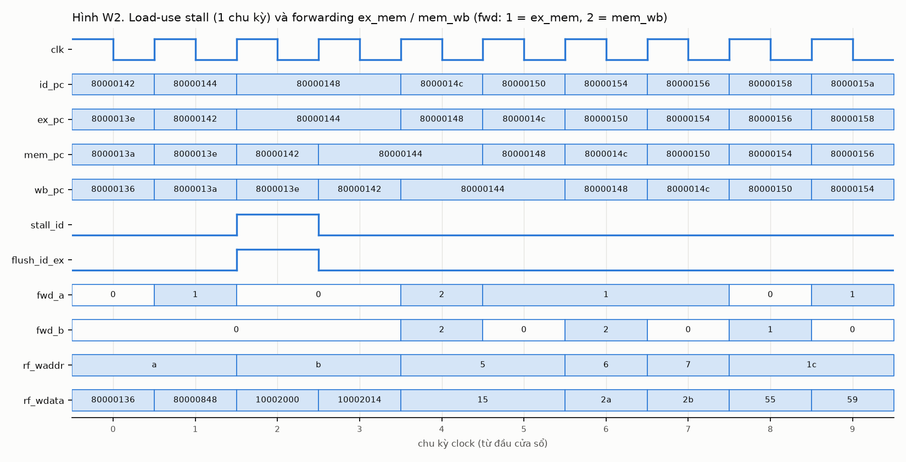
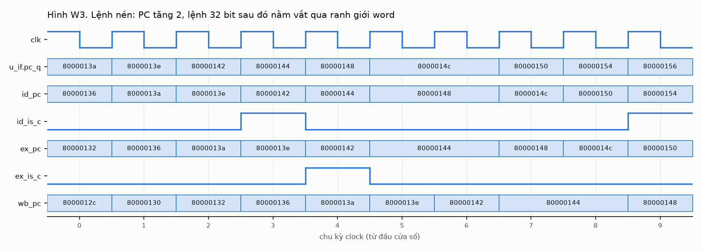
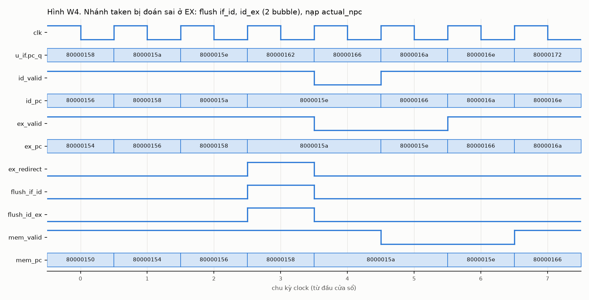
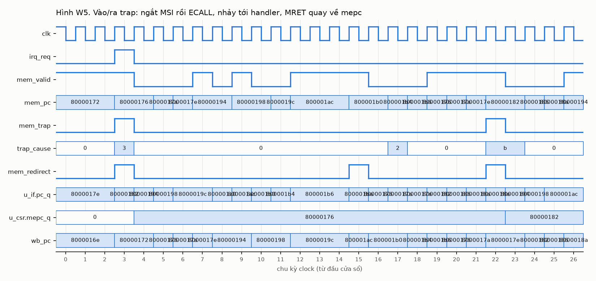
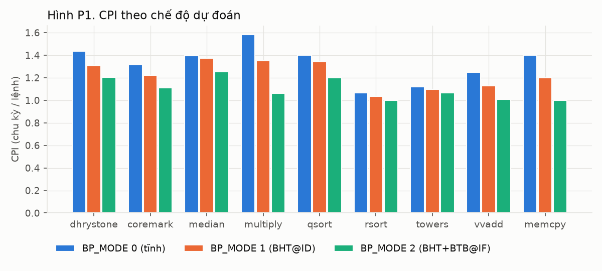
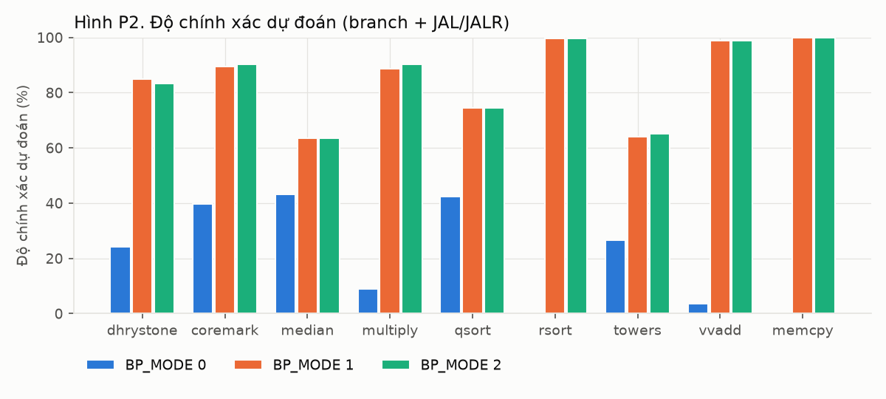
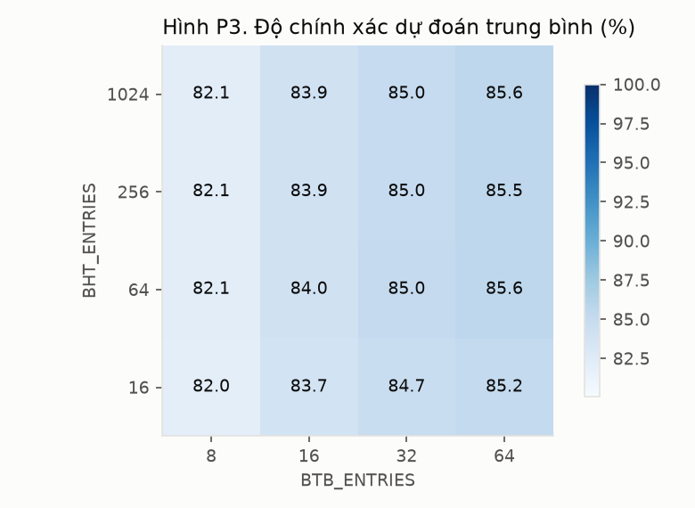
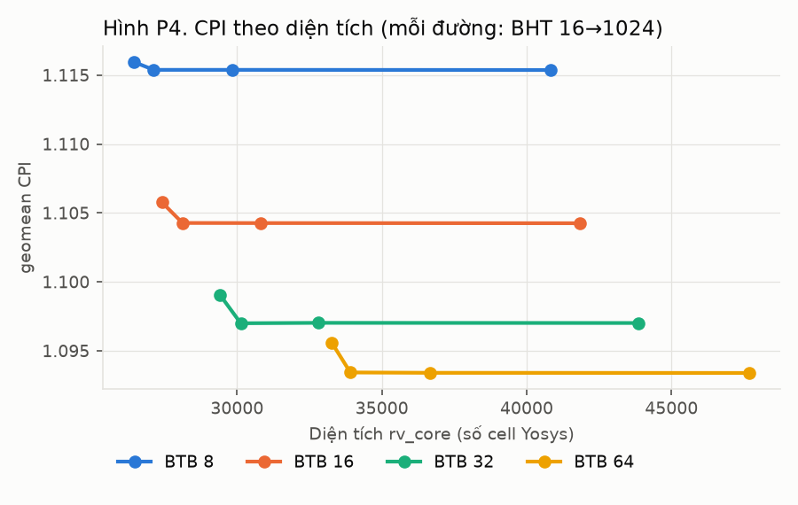
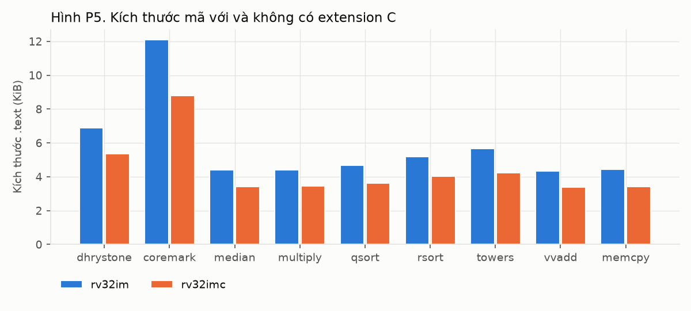
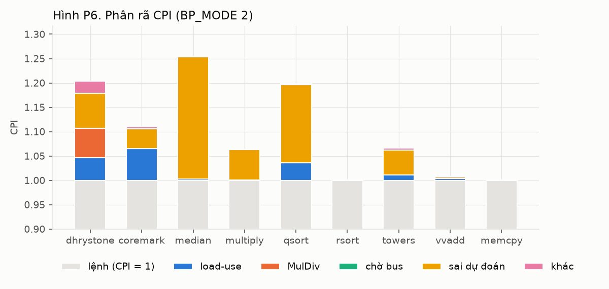

# Chương 4. Xác minh và đánh giá

Mọi bảng trong chương này được trích từ các file trong `results/` (ghi ở chú thích bảng) và được sinh lại bằng `scripts/make_chapter4.py`; lệnh tái tạo số liệu ghi trong `docs/giai_thich/huong_dan_chay.md`.

## 4.1. Môi trường xác minh ba mức

1. **Mức khối** – 13 testbench SystemVerilog tự kiểm tra (Verilator `--binary --timing`), mỗi testbench có mô hình tham chiếu, test có hướng với giá trị biên và test ngẫu nhiên có seed (`+seed=`). Bộ giải nén C được so với bảng kỳ vọng do chính GNU assembler sinh (`.option rvc` / `.option norvc`).
2. **Mức lõi** – bộ riscv-tests chính thức, chạy với môi trường riêng chỉ có Machine mode, trên ma trận cấu hình RTL × biến thể ELF; commit log của RTL được so khớp từng lệnh với mô hình tham chiếu Spike.
3. **Mức hệ thống** – firmware C chạy trên `tb_soc` cùng các BFM: UART (giải mã TX, gửi RX), flash SPI kiểu W25Q (CS0), SPI slave đủ 4 mode (CS1), kích thích GPIO. Tiêu chí PASS: mã thoát 0, output UART khớp file kỳ vọng, BFM không phát hiện lỗi.

Bảng 4.1. Kết quả unit testbench (nguồn: `results/unit/summary.md`).

| Testbench | Kết quả | Seed | Thời gian (s) | Ghi chú |
|---|---|---|---|---|
| tb_alu | PASS | 1 | 2.9 | 15440 checks |
| tb_regfile | PASS | 1 | 2.8 | 40134 checks |
| tb_muldiv | PASS | 1 | 2.8 | 4316 checks |
| tb_compressed_decoder | PASS | 1 | 2.8 | 2104 checks |
| tb_bp | PASS | 1 | 2.9 | 6304 checks |
| tb_csr | PASS | 1 | 6.2 | 136 checks |
| tb_fifo | PASS | 1 | 3.1 | 77335 checks |
| tb_apb_bridge | PASS | 1 | 2.9 | 3037 checks |
| tb_uart | PASS | 1 | 3.6 | 549 checks |
| tb_spi | PASS | 1 | 5.0 | 395 checks |
| tb_timer | PASS | 1 | 3.9 | 220 checks |
| tb_gpio | PASS | 1 | 3.4 | 617 checks |
| tb_intc | PASS | 1 | 3.5 | 2209 checks |

## 4.2. riscv-tests

Tổng cộng 351 lượt test PASS, 0 FAIL trên 6 cấu hình (Bảng 4.2). Ba test được loại trừ có lý do: `rv32ui-p-ma_data` (lõi trap khi truy cập không căn lề – hợp lệ theo đặc tả, hành vi trap được kiểm bởi `rv32mi-p-ma_addr`), `rv32mi-p-breakpoint` (cần CSR debug trigger, dòng 33 `csrw tselect, x0`) và `rv32mi-p-pmpaddr` (cần PMP, dòng 27 `csrw pmpcfg0, zero`).

Bảng 4.2. riscv-tests theo cấu hình (nguồn: `results/isa/summary.md`).

| Cấu hình RTL | ELF | Bộ test | PASS | FAIL | EXCLUDED |
|---|---|---|---|---|---|
| `m1c1_bp0` | `imc` | rv32ui,rv32um,rv32uc,rv32mi | 64 | 0 | 3 |
| `m1c1_bp1` | `imc` | rv32ui,rv32um,rv32uc,rv32mi | 64 | 0 | 3 |
| `m1c1_bp2` | `imc` | rv32ui,rv32um,rv32uc,rv32mi | 64 | 0 | 3 |
| `m1c0_bp2` | `im` | rv32ui,rv32um,rv32mi | 63 | 0 | 3 |
| `m0c0_bp2` | `i` | rv32ui,rv32mi | 55 | 0 | 3 |
| `sc` | `i` | rv32ui | 41 | 0 | 1 |

## 4.3. So sánh với Spike

Lõi in commit log tại WB theo định dạng `spike --log-commits`; script `compare_spike.py` so khớp từng lệnh (PC, mã lệnh, thanh ghi đích và giá trị, địa chỉ và dữ liệu store). Giá trị đọc từ các bộ đếm phụ thuộc thời gian được đánh dấu "taint" và theo dõi qua thanh ghi và bộ nhớ; khi luồng lệnh rẽ khác ngay sau một nhánh phụ thuộc giá trị đó (in số chu kỳ), so sánh dừng lock-step và chỉ so mã thoát. Khác biệt tùy hiện thực được liệt kê: `marchid` (RTL 0, Spike 5) và `misa` (Spike cho phép xóa bit C, lõi này không – test `rv32mi-p-ma_fetch` rẽ nhánh khác sau đó).

Bảng 4.3. Kết quả so sánh (nguồn: `results/spike/summary.md`; chi tiết từng chương trình trong `results/spike/<cấu hình>.md`).

| Cấu hình | MATCH | Tổng |
|---|---|---|
| `m1c1_bp2` | 73 | 73 |
| `m1c0_bp2` | 72 | 72 |
| `m0c0_bp2` | 64 | 64 |
| `sc` | 50 | 50 |

## 4.4. System test

Bảng 4.4. System test (nguồn: `results/systest/summary.md`).

| Test | Cấu hình RTL | Kết quả | Chu kỳ | Ghi chú |
|---|---|---|---|---|
| hello | `m1c1_bp2` | PASS | 12135 |  |
| uart_irq_echo | `m1c1_bp2` | PASS | 44819 | RESULT uart_irq_echo: PASS (79 checks, 0 errors) |
| spi_flash | `m1c1_bp2` | PASS | 71663 | RESULT spi_flash: PASS (281 checks, 0 errors) |
| spi_modes | `m1c1_bp2` | PASS | 63188 | RESULT spi_modes: PASS (16 checks, 0 errors) |
| timer_irq | `m1c1_bp2` | PASS | 40534 | RESULT timer_irq: PASS (23 checks, 0 errors) |
| timer_irq | `sc` | PASS | 40355 | RESULT timer_irq: PASS (23 checks, 0 errors) |
| gpio_irq | `m1c1_bp2` | PASS | 15795 | RESULT gpio_irq: PASS (11 checks, 0 errors) |
| irq_priority | `m1c1_bp2` | PASS | 21746 | RESULT irq_priority: PASS (8 checks, 0 errors) |
| irq_priority | `sc` | PASS | 21546 | RESULT irq_priority: PASS (8 checks, 0 errors) |
| exceptions | `m1c1_bp2` | PASS | 129554 | RESULT exceptions: PASS (62 checks, 0 errors) |
| exceptions | `m1c0_bp2` | PASS | 132125 | RESULT exceptions: PASS (66 checks, 0 errors) |
| exceptions | `sc` | PASS | 132102 | RESULT exceptions: PASS (66 checks, 0 errors) |
| irq_during_div | `m1c1_bp2` | PASS | 494430 | RESULT irq_during_div: PASS (3 checks, 0 errors) |
| demo | `m1c1_bp2` | PASS | 4088021 |  |
| branch_smc | `m1c1_bp2` | PASS | 24718 | RESULT branch_smc: PASS (4 checks, 0 errors) |
| branch_smc | `m1c1_bp0` | PASS | 24775 | RESULT branch_smc: PASS (4 checks, 0 errors) |
| branch_smc | `sc` | PASS | 24691 | RESULT branch_smc: PASS (4 checks, 0 errors) |

## 4.5. Waveform minh họa

Các hình được sinh tự động từ VCD bằng `scripts/make_waves.py`; trục hoành tính theo chu kỳ clock.









Các hình giao dịch APB, khung UART và khung SPI mode 0/3 được trình bày ở Chương 3 (Hình 3.3, 3.5, 3.7, 3.8). Bảng diễn biến pipeline theo từng chu kỳ của đoạn chương trình minh họa: `results/waves/walkthrough_table.md` và phần giải thích trong `docs/giai_thich/walkthrough_pipeline.md`.

## 4.6. Coverage

Bảng 4.5. Line và toggle coverage theo thư mục (nguồn: `results/coverage/summary.md`; các dòng chưa phủ được liệt kê trong `results/coverage/uncovered.md`).

| Thư mục | Line | Toggle |
|---|---|---|
| rtl (khác) | 100.0% (92/92) | 97.4% (151/155) |
| rtl/core | 99.8% (592/593) | 100.0% (476/476) |
| rtl/periph | 97.5% (119/122) | 98.6% (212/215) |

Functional coverage: 71/71 điểm `cover property` đạt (`results/coverage/functional.md`), gồm mọi nhóm lệnh, 8 lệnh M, lệnh nén, 4 đường forward, các loại stall, sai dự đoán theo loại, mọi mcause, ngắt khi bộ chia đang chạy, trap ngay sau nhánh sai, lệnh 32 bit vắt qua ranh giới word, 4 mode SPI, định dạng UART và trạng thái đầy/rỗng của các FIFO.

## 4.7. Hiệu năng

Mọi benchmark đo trong vùng đo (giữa hai lần gọi `setStats`/`start_time`) bằng `mcycle`, `minstret` và `mhpmcounter3..10`.

### 4.7.1. Bộ dự đoán rẽ nhánh

Geomean CPI trên 9 benchmark giảm từ 1.320 (BP_MODE 0) xuống 1.223 (BP_MODE 1) và 1.097 (BP_MODE 2). Dhrystone: 1.435 → 1.307 → 1.204. CoreMark: 2.43 → 2.62 → 2.88 CoreMark/MHz (2 iteration). Kiểm tra hợp lý của đặc tả (CPI Dhrystone trong [1,0; 2,0] và BP_MODE 2 không tệ hơn BP_MODE 0) đều đạt.

Bảng 4.6. CPI, độ chính xác, penalty (nguồn: `results/perf/exp1_predictor.csv`).

| Benchmark | CPI BP0 | CPI BP1 | CPI BP2 | Acc BP0 | Acc BP1 | Acc BP2 | Penalty BP0 | Penalty BP1 | Penalty BP2 |
|---|---|---|---|---|---|---|---|---|---|
| dhrystone | 1.435 | 1.307 | 1.204 | 24.2% | 85.0% | 83.3% | 98704 | 60615 | 27516 |
| coremark | 1.314 | 1.220 | 1.110 | 39.8% | 89.5% | 90.2% | 165288 | 108586 | 29885 |
| median | 1.396 | 1.375 | 1.255 | 43.1% | 63.6% | 63.6% | 5276 | 4725 | 2414 |
| multiply | 1.585 | 1.350 | 1.063 | 8.9% | 88.7% | 90.2% | 26096 | 16508 | 2884 |
| qsort | 1.399 | 1.341 | 1.199 | 42.3% | 74.5% | 74.5% | 90000 | 68981 | 23089 |
| rsort | 1.066 | 1.033 | 1.000 | 0.7% | 99.7% | 99.6% | 32226 | 16377 | 353 |
| towers | 1.119 | 1.099 | 1.067 | 26.6% | 64.0% | 65.1% | 2412 | 1656 | 678 |
| vvadd | 1.250 | 1.129 | 1.008 | 3.5% | 98.7% | 98.7% | 2984 | 1645 | 246 |
| memcpy | 1.399 | 1.200 | 1.001 | 0.4% | 99.9% | 99.9% | 21508 | 10905 | 250 |
| **geomean CPI** | 1.320 | 1.223 | 1.097 | | | | | | |





### 4.7.2. Kích thước BHT và BTB

Bảng 4.7. Độ chính xác trung bình / geomean CPI / diện tích theo BHT × BTB (nguồn: `results/perf/exp2_sweep.csv`, `results/synth/summary.json`).

| BHT \ BTB | 8 | 16 | 32 | 64 |
|---|---|---|---|---|
| 16 | 82.0% / 1.116 / 26426 cell | 83.7% / 1.106 / 27402 cell | 84.7% / 1.099 / 29403 cell | 85.2% / 1.096 / 33265 cell |
| 64 | 82.1% / 1.115 / 27123 cell | 84.0% / 1.104 / 28115 cell | 85.0% / 1.097 / 30127 cell | 85.6% / 1.093 / 33911 cell |
| 256 | 82.1% / 1.115 / 29828 cell | 83.9% / 1.104 / 30808 cell | 85.0% / 1.097 / 32797 cell | 85.5% / 1.093 / 36671 cell |
| 1024 | 82.1% / 1.115 / 40824 cell | 83.9% / 1.104 / 41822 cell | 85.0% / 1.097 / 43843 cell | 85.6% / 1.093 / 47685 cell |

Độ chính xác chủ yếu phụ thuộc kích thước BTB (82.1% với 8 entry lên 85.5% với 64 entry, BHT 256), còn BHT lớn hơn 64 entry gần như không cải thiện (85.0% so với 85.0% ở BTB 32) vì các benchmark có ít nhánh nóng; trong khi đó diện tích tăng mạnh theo BHT (30127 → 43843 cell) vì bảng làm bằng flip-flop. Điểm cân bằng hợp lý cho các tải này là BHT 64 × BTB 32.





### 4.7.3. Extension C

Tổng kích thước `.text` của 9 benchmark giảm từ 53388 xuống 40676 byte (23.8%), trong khi CPI gần như không đổi.

Bảng 4.8. Kích thước mã và CPI (nguồn: `results/perf/exp3_rvc.csv`).

| Benchmark | .text im | .text imc | Giảm | Lệnh nén (%) | Chu kỳ im | Chu kỳ imc | CPI im | CPI imc |
|---|---|---|---|---|---|---|---|---|
| dhrystone | 7068 | 5488 | 22.4% | 54.5% | 338104 | 333617 | 1.220 | 1.204 |
| coremark | 12404 | 8992 | 27.5% | 54.8% | 702058 | 695588 | 1.120 | 1.110 |
| median | 4496 | 3504 | 22.1% | 64.7% | 5402 | 5404 | 1.254 | 1.255 |
| multiply | 4508 | 3520 | 21.9% | 83.1% | 22282 | 22282 | 1.063 | 1.063 |
| qsort | 4796 | 3716 | 22.5% | 42.9% | 148615 | 148150 | 1.203 | 1.199 |
| rsort | 5328 | 4140 | 22.3% | 47.3% | 171250 | 171242 | 1.000 | 1.000 |
| towers | 5812 | 4332 | 25.5% | 66.1% | 4037 | 4028 | 1.069 | 1.067 |
| vvadd | 4440 | 3468 | 21.9% | 74.1% | 2489 | 2489 | 1.008 | 1.008 |
| memcpy | 4536 | 3516 | 22.5% | 40.0% | 20110 | 20110 | 1.001 | 1.001 |
| **tổng** | 53388 | 40676 | 23.8% | | | | | |



### 4.7.4. Phân rã CPI

Bảng 4.9. Phân rã CPI ở BP_MODE 2 (nguồn: `results/perf/exp4_cpi_breakdown.csv`).

| Benchmark | CPI | load-use | MulDiv | bus | mispredict | other |
|---|---|---|---|---|---|---|
| dhrystone | 1.204 | 0.047 | 0.059 | 0.000 | 0.072 | 0.025 |
| coremark | 1.110 | 0.065 | 0.000 | 0.000 | 0.041 | 0.004 |
| median | 1.255 | 0.002 | 0.000 | 0.000 | 0.252 | 0.001 |
| multiply | 1.063 | 0.001 | 0.000 | 0.000 | 0.063 | 0.000 |
| qsort | 1.199 | 0.036 | 0.000 | 0.000 | 0.161 | 0.003 |
| rsort | 1.000 | 0.000 | 0.000 | 0.000 | 0.000 | 0.000 |
| towers | 1.067 | 0.012 | 0.000 | 0.000 | 0.051 | 0.004 |
| vvadd | 1.008 | 0.004 | 0.000 | 0.000 | 0.003 | 0.001 |
| memcpy | 1.001 | 0.001 | 0.000 | 0.000 | 0.000 | 0.000 |



Sai dự đoán là nguồn mất chu kỳ lớn nhất ở các benchmark có nhánh phụ thuộc dữ liệu (median, qsort); load-use đáng kể ở CoreMark và Dhrystone; stall MulDiv chỉ xuất hiện ở Dhrystone (một phép chia mỗi vòng); các benchmark không truy cập ngoại vi trong vùng đo nên không có chờ bus.

### 4.7.5. Single-cycle so với pipeline

Bảng 4.10. CPI, Fmax và hiệu năng tương đối (nguồn: `results/perf/exp5_sc_vs_pipeline.csv`).

| Lõi | geomean CPI | Dhrystone CPI | Fmax (MHz) | Fmax/CPI | Hiệu năng tương đối |
|---|---|---|---|---|---|
| rv_core_sc (single-cycle, RV32I) | 1.000 | 1.000 | 25.59 | 25.6 | 1.00× |
| rv_core pipeline RV32I | 1.104 | 1.178 | 47.16 | 42.7 | 1.67× |
| rv_core pipeline RV32IMC | 1.097 | 1.204 | 42.27 | 38.5 | 1.51× |

Pipeline có CPI lớn hơn 1 một chút nhưng tần số SoC cao hơn nhiều so với single-cycle (đường tổ hợp của single-cycle đi qua RAM hai lần), nên hiệu năng (∝ Fmax/CPI) cao hơn rõ rệt; phiên bản RV32I có Fmax cao hơn RV32IMC vì không có bộ nhân nằm trên đường găng.

## 4.8. Diện tích, Fmax và đường găng

Diện tích tính bằng số cell sau Yosys `synth -flatten` (thư viện generic), **không gồm RAM 128 KB** (black box). Fmax là ước lượng trên FPGA Lattice ECP5 (nextpnr); không thực hiện place & route ASIC.

Bảng 4.11. Diện tích (nguồn: `results/synth/area.csv`).

| Khối | Tham số | Cell | Flip-flop |
|---|---|---|---|
| `rv_core_m1c1_bp0` | {'ENABLE_M': 1, 'ENABLE_C': 1, 'BP_MODE': 0} | 24568 | 2532 |
| `rv_core_m1c1_bp1` | {'ENABLE_M': 1, 'ENABLE_C': 1, 'BP_MODE': 1} | 28926 | 3045 |
| `rv_core_m1c1_bp2` | {'ENABLE_M': 1, 'ENABLE_C': 1, 'BP_MODE': 2} | 32797 | 4966 |
| `rv_core_m1c0_bp2` | {'ENABLE_M': 1, 'ENABLE_C': 0, 'BP_MODE': 2} | 30987 | 4871 |
| `rv_core_m0c0_bp2` | {'ENABLE_M': 0, 'ENABLE_C': 0, 'BP_MODE': 2} | 21368 | 4699 |
| `rv_core_sc` | – | 10474 | 1509 |
| `uart_apb` | – | 1457 | 411 |
| `spi_apb` | – | 1145 | 364 |
| `timer64_apb` | – | 1245 | 146 |
| `gpio_apb` | – | 611 | 130 |
| `intc_apb` | – | 54 | 3 |
| `apb_bridge` | – | 180 | 71 |
| `dbus_xbar` | – | 170 | 0 |
| `sim_ctrl` | – | 18 | 0 |
| `rst_sync` | – | 2 | 2 |
| `soc_top` | – | 37769 | 6077 |

Bảng 4.12. Tài nguyên ECP5 và Fmax (nguồn: `results/synth/summary.md`).

| Thiết kế | LUT4 | FF | Fmax (MHz) | Đường găng (tóm tắt) |
|---|---|---|---|---|
| `m1c1_bp2` | 9039 | 4966 | 43.85 | `u_ex.mem_rd` → `dbus_addr` (41 chặng logic/định tuyến) |
| `m1c1_bp0` | 5780 | 2532 | 47.91 | `u_ex.mem_rd` → `dbus_addr` (35 chặng logic/định tuyến) |
| `m0c0_bp2` | 8078 | 4699 | 46.47 | `u_ex.mem_insn` → `u_if.id_insn` (37 chặng logic/định tuyến) |
| `sc` | 4493 | 1509 | 44.22 | `u_csr.wdata` → `irq_meip` (24 chặng logic/định tuyến) |
| `soc_top_1k` | 11397 | 5565 | 42.27 | `g_pipe.u_core.u_ex.mem_rd` → `g_pipe.u_core.u_ex.fwd_rs2` (42 chặng logic/định tuyến) |
| `soc_top_m0c0_1k` | 10518 | 5298 | 47.16 | `g_pipe.u_core.u_ex.mem_rd` → `g_pipe.u_core.u_if.id_insn` (46 chặng logic/định tuyến) |
| `soc_top_sc_1k` | 9061 | 2108 | 25.59 | `g_sc.u_core.pc_q` → `u_ram.mem.0.58_DO_1` (55 chặng logic/định tuyến) |

Đường găng của lõi `m1c1_bp2` (43.85 MHz) gồm các chặng sau (trích `results/synth/critical_path_m1c1_bp2.txt`, chỉ giữ tên nguồn/đích):

```
Source u_ex.mem_rd_TRELLIS_FF_Q_1.Q
Sink   u_ex.mem_rd_we_LUT4_B_Z_LUT4_Z_1.C
Source u_ex.mem_rd_we_LUT4_B_Z_LUT4_Z_1.F
Sink   u_bp.genblk1.g_btb_if.u_btb.wr_target_LUT4_Z_26_D_CCU2C_S1_A0_LUT4_B_D_LUT4_D_Z_PFUMX_Z_ALUT_LUT4_Z_
Source u_bp.genblk1.g_btb_if.u_btb.wr_target_LUT4_Z_26_D_CCU2C_S1_A0_LUT4_B_D_LUT4_D_Z_PFUMX_Z_ALUT_LUT4_Z_
Sink   u_bp.genblk1.g_btb_if.u_btb.wr_target_LUT4_Z_26_D_CCU2C_S1_A0_LUT4_B_D_LUT4_D_Z_PFUMX_Z_2_ALUT_LUT4_
Source u_bp.genblk1.g_btb_if.u_btb.wr_target_LUT4_Z_26_D_CCU2C_S1_A0_LUT4_B_D_LUT4_D_Z_PFUMX_Z_2_ALUT_LUT4_
Sink   u_bp.genblk1.g_btb_if.u_btb.wr_target_LUT4_Z_26_D_CCU2C_S1_A0_LUT4_B_D_LUT4_D_Z_PFUMX_Z_ALUT_LUT4_Z_
Source u_bp.genblk1.g_btb_if.u_btb.wr_target_LUT4_Z_26_D_CCU2C_S1_A0_LUT4_B_D_LUT4_D_Z_PFUMX_Z_ALUT_LUT4_Z_
Sink   u_ex.fwd_rs1_PFUMX_Z_14_BLUT_LUT4_Z.M
Source u_ex.fwd_rs1_PFUMX_Z_14_BLUT_LUT4_Z.OFX
Sink   u_id.ex_funct3_LUT4_A.D
   ... (63 chặng giữa) ...
Sink   u_id.ex_is_c_CCU2C_A0_COUT_CCU2C_CIN_S1_LUT4_C_Z_LUT4_Z_1_D_CCU2C_S0_CIN_CCU2C_COUT_CIN_CCU2C_COUT_C
Source u_id.ex_is_c_CCU2C_A0_COUT_CCU2C_CIN_S1_LUT4_C_Z_LUT4_Z_1_D_CCU2C_S0_CIN_CCU2C_COUT_CIN_CCU2C_COUT_C
Sink   u_ex.result_PFUMX_Z_11_BLUT_LUT4_Z.M
Source u_ex.result_PFUMX_Z_11_BLUT_LUT4_Z.OFX
Sink   dbus_addr_TRELLIS_FF_Q.M
Source dbus_addr_TRELLIS_FF_Q.M
```

Đường găng bắt đầu ở thanh ghi `ex_mem` (chỉ số `rd` của lệnh ở MEM), qua bộ so sánh forward và mux toán hạng (`fwd_rs1/fwd_rs2`), vào **bộ nhân** (khối DSP `MULT18X18D` của ECP5, cùng chuỗi cộng carry `CCU2C` ghép các tích riêng 18×18 thành tích 33×33), rồi qua mux chọn kết quả về thanh ghi `ex_mem.result` (tên `dbus_addr` sau tổng hợp vì nó điều khiển trực tiếp địa chỉ bus). Đây đúng là ứng viên mà đặc tả dự kiến: bộ nhân tổ hợp 1 chu kỳ đứng sau chuỗi forwarding. Hướng cải thiện: chia bộ nhân thành 2 tầng (MulDiv nhiều chu kỳ cho MULH*), hoặc dùng thanh ghi đầu ra DSP.

Với SoC dùng lõi single-cycle (`soc_top_sc_1k`, 25.59 MHz), đường găng đi từ `pc_q` qua cổng đọc lệnh của RAM, giải mã, tệp thanh ghi, ALU tới cổng dữ liệu RAM – toàn bộ trong một chu kỳ, nên tần số thấp hơn hẳn SoC pipeline (`soc_top_1k`: 42.27 MHz). Fmax của lõi đứng riêng (Bảng 4.12, dòng `sc`) không gồm RAM nên không dùng để so sánh.
