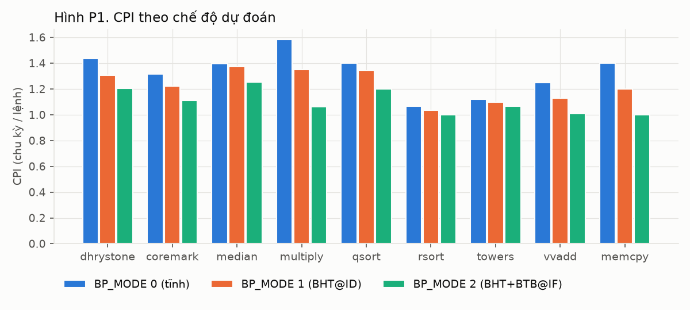
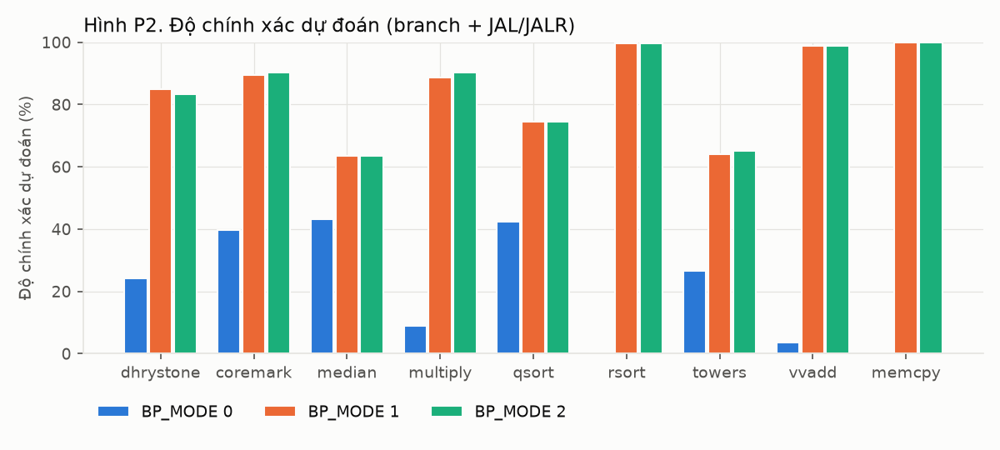
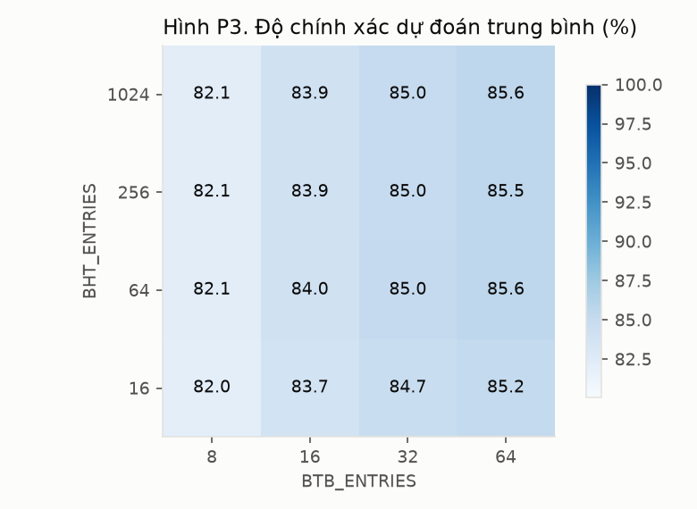
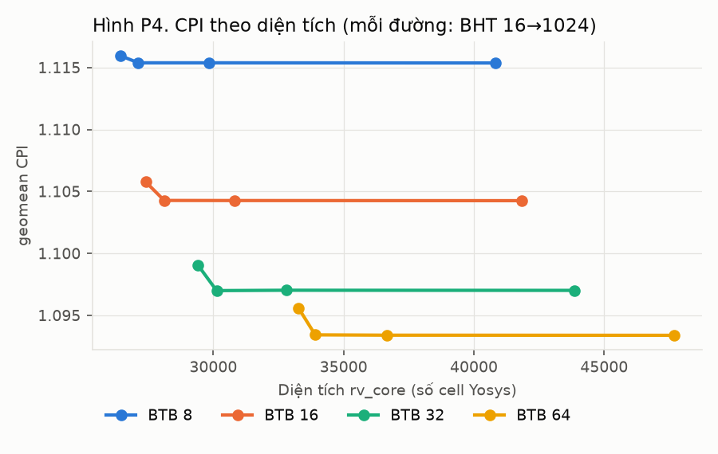
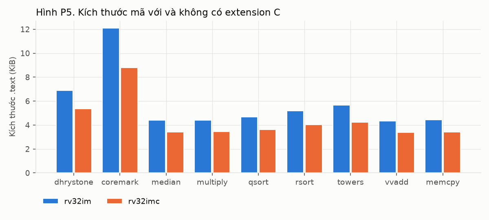
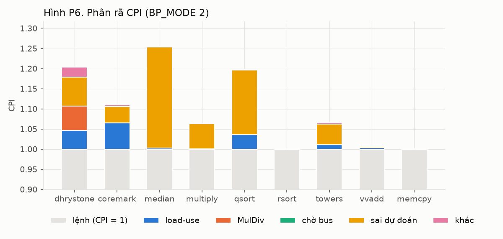

# Kết quả

Tài liệu này được ghép tự động từ các file trong `results/` bằng `scripts/make_results_md.py`; mọi số liệu là số đo thật từ các lần chạy gần nhất. Lệnh tái tạo ghi trong từng mục và trong `docs/giai_thich/huong_dan_chay.md`.

## 1. Regression tổng

Nguồn: `results/regress.md`.

| Bước | Kết quả | Thời gian (s) |
|---|---|---|
| lint | PASS | 3 |
| unit | PASS | 46 |
| sw | PASS | 0 |
| isa | PASS | 31 |
| spike | PASS | 137 |
| systest | PASS | 6 |

Tổng: PASS. Tái tạo: `make regress`.

## 2. Unit testbench

Nguồn: `results/unit/summary.md`.

| Testbench | Kết quả | Seed | Thời gian (s) | Ghi chú |
|---|---|---|---|---|
| tb_alu | PASS | 1 | 2.9 | 15440 checks |
| tb_regfile | PASS | 1 | 2.8 | 40134 checks |
| tb_muldiv | PASS | 1 | 2.8 | 4316 checks |
| tb_compressed_decoder | PASS | 1 | 2.8 | 2104 checks |
| tb_bp | PASS | 1 | 2.9 | 6304 checks |
| tb_csr | PASS | 1 | 6.2 | 136 checks |
| tb_fifo | PASS | 1 | 3.1 | 77335 checks |
| tb_apb_bridge | PASS | 1 | 2.9 | 3037 checks |
| tb_uart | PASS | 1 | 3.6 | 549 checks |
| tb_spi | PASS | 1 | 5.0 | 395 checks |
| tb_timer | PASS | 1 | 3.9 | 220 checks |
| tb_gpio | PASS | 1 | 3.4 | 617 checks |
| tb_intc | PASS | 1 | 3.5 | 2209 checks |

Tái tạo: `make unit` (= `.venv/bin/python scripts/run_unit.py`)

## 3. riscv-tests – ma trận cấu hình

Nguồn: `results/isa/summary.md`.

| Cấu hình RTL | ELF | Bộ test | PASS | FAIL | EXCLUDED |
|---|---|---|---|---|---|
| `m1c1_bp0` | `imc` | rv32ui,rv32um,rv32uc,rv32mi | 64 | 0 | 3 |
| `m1c1_bp1` | `imc` | rv32ui,rv32um,rv32uc,rv32mi | 64 | 0 | 3 |
| `m1c1_bp2` | `imc` | rv32ui,rv32um,rv32uc,rv32mi | 64 | 0 | 3 |
| `m1c0_bp2` | `im` | rv32ui,rv32um,rv32mi | 63 | 0 | 3 |
| `m0c0_bp2` | `i` | rv32ui,rv32mi | 55 | 0 | 3 |
| `sc` | `i` | rv32ui | 41 | 0 | 1 |

Test bị loại trừ và lý do:

- `rv32mi-p-breakpoint`: cần CSR debug trigger (Sdtrig) – isa/rv64mi/breakpoint.S dòng 33 `csrw tselect, x0` trap illegal vì lõi không hiện thực tselect/tdata1/tdata2 (chỉ M-mode, không có debug module)
- `rv32mi-p-pmpaddr`: cần PMP – isa/rv64mi/pmpaddr.S dòng 27 `csrw pmpcfg0, zero` trap illegal vì lõi không hiện thực PMP (spec mục 10.2 cho phép loại trừ)
- `rv32ui-p-ma_data`: core traps on misaligned load/store (allowed by the spec); the trap behaviour is checked by rv32mi-p-ma_addr

Tái tạo: `make isa` (= `.venv/bin/python scripts/run_isa.py --matrix`)

Ghi chú loại trừ: `rv32ui-p-ma_data` được phép loại trừ theo spec (lõi trap khi truy cập không căn lề, hành vi trap được kiểm bởi `rv32mi-p-ma_addr` và `*-misaligned`); `rv32mi-p-breakpoint` và `rv32mi-p-pmpaddr` phụ thuộc debug trigger / PMP mà lõi không có – dòng nguồn phụ thuộc được ghi ở trên.

## 4. So sánh với Spike

Nguồn: `results/spike/summary.md`.

| Cấu hình | MATCH | Tổng |
|---|---|---|
| `m1c1_bp2` | 73 | 73 |
| `m1c0_bp2` | 72 | 72 |
| `m0c0_bp2` | 64 | 64 |
| `sc` | 50 | 50 |

Tái tạo: `make spike`

Mức so sánh: `--log-commits` (PC, mã lệnh, thanh ghi đích + giá trị, địa chỉ + dữ liệu store), so khớp từng lệnh bằng regex (`scripts/compare_spike.py`). Khác biệt đã biết và được liệt kê (không che giấu): giá trị đọc `marchid` (RTL 0, Spike 5); `misa` ghi được trong Spike (test `rv32mi-p-ma_fetch` xóa bit C rồi rẽ nhánh khác – kết quả KNOWN); các giá trị đọc từ `cycle/mcycle/instret/minstret/time/mhpmcounter*` phụ thuộc thời gian, được theo dõi taint qua thanh ghi và bộ nhớ (decision D19). Truy cập không căn lề: cả RTL và Spike đều trap nên không phát sinh khác biệt. Chi tiết từng chương trình: `results/spike/<cấu hình>.md`.

## 5. System test

Nguồn: `results/systest/summary.md`.

| Test | Cấu hình RTL | Kết quả | Chu kỳ | Ghi chú |
|---|---|---|---|---|
| hello | `m1c1_bp2` | PASS | 12135 |  |
| uart_irq_echo | `m1c1_bp2` | PASS | 44819 | RESULT uart_irq_echo: PASS (79 checks, 0 errors) |
| spi_flash | `m1c1_bp2` | PASS | 71663 | RESULT spi_flash: PASS (281 checks, 0 errors) |
| spi_modes | `m1c1_bp2` | PASS | 63188 | RESULT spi_modes: PASS (16 checks, 0 errors) |
| timer_irq | `m1c1_bp2` | PASS | 40534 | RESULT timer_irq: PASS (23 checks, 0 errors) |
| timer_irq | `sc` | PASS | 40355 | RESULT timer_irq: PASS (23 checks, 0 errors) |
| gpio_irq | `m1c1_bp2` | PASS | 15795 | RESULT gpio_irq: PASS (11 checks, 0 errors) |
| irq_priority | `m1c1_bp2` | PASS | 21746 | RESULT irq_priority: PASS (8 checks, 0 errors) |
| irq_priority | `sc` | PASS | 21546 | RESULT irq_priority: PASS (8 checks, 0 errors) |
| exceptions | `m1c1_bp2` | PASS | 129554 | RESULT exceptions: PASS (62 checks, 0 errors) |
| exceptions | `m1c0_bp2` | PASS | 132125 | RESULT exceptions: PASS (66 checks, 0 errors) |
| exceptions | `sc` | PASS | 132102 | RESULT exceptions: PASS (66 checks, 0 errors) |
| irq_during_div | `m1c1_bp2` | PASS | 494430 | RESULT irq_during_div: PASS (3 checks, 0 errors) |
| demo | `m1c1_bp2` | PASS | 4088021 |  |
| branch_smc | `m1c1_bp2` | PASS | 24718 | RESULT branch_smc: PASS (4 checks, 0 errors) |
| branch_smc | `m1c1_bp0` | PASS | 24775 | RESULT branch_smc: PASS (4 checks, 0 errors) |
| branch_smc | `sc` | PASS | 24691 | RESULT branch_smc: PASS (4 checks, 0 errors) |

Tiêu chí PASS: mã thoát 0 từ SIM_CTRL, output UART khớp file kỳ vọng (nếu có), không có lỗi frame/parity ở BFM UART, không có lỗi giao thức ở BFM flash.

Tái tạo: `make systest` (= `.venv/bin/python scripts/run_systest.py`)

## 6. Hiệu năng

Nguồn: `results/perf/summary.md`.

Số liệu đo trong vùng đo của từng benchmark (giữa hai lần `setStats`/`start_time`) bằng `mcycle`, `minstret`, `mhpmcounter3..10`. Tái tạo: `make perf` (= `.venv/bin/python scripts/run_perf.py`).

### Thí nghiệm 1 – Bộ dự đoán rẽ nhánh (rv32imc, BHT 256, BTB 32)

Bảng P1. CPI, độ chính xác dự đoán (branch + jump) và chu kỳ penalty (toàn chương trình = 2×redirect ở EX + 1×redirect ở ID). Nguồn: `results/perf/exp1_predictor.csv`.

| Benchmark | CPI BP0 | CPI BP1 | CPI BP2 | Acc BP0 | Acc BP1 | Acc BP2 | Penalty BP0 | Penalty BP1 | Penalty BP2 |
|---|---|---|---|---|---|---|---|---|---|
| dhrystone | 1.435 | 1.307 | 1.204 | 24.2% | 85.0% | 83.3% | 98704 | 60615 | 27516 |
| coremark | 1.314 | 1.220 | 1.110 | 39.8% | 89.5% | 90.2% | 165288 | 108586 | 29885 |
| median | 1.396 | 1.375 | 1.255 | 43.1% | 63.6% | 63.6% | 5276 | 4725 | 2414 |
| multiply | 1.585 | 1.350 | 1.063 | 8.9% | 88.7% | 90.2% | 26096 | 16508 | 2884 |
| qsort | 1.399 | 1.341 | 1.199 | 42.3% | 74.5% | 74.5% | 90000 | 68981 | 23089 |
| rsort | 1.066 | 1.033 | 1.000 | 0.7% | 99.7% | 99.6% | 32226 | 16377 | 353 |
| towers | 1.119 | 1.099 | 1.067 | 26.6% | 64.0% | 65.1% | 2412 | 1656 | 678 |
| vvadd | 1.250 | 1.129 | 1.008 | 3.5% | 98.7% | 98.7% | 2984 | 1645 | 246 |
| memcpy | 1.399 | 1.200 | 1.001 | 0.4% | 99.9% | 99.9% | 21508 | 10905 | 250 |
| **geomean CPI** | 1.320 | 1.223 | 1.097 | | | | | | |

### Thí nghiệm 2 – Quét kích thước BHT × BTB (BP_MODE 2)

Bảng P2. Độ chính xác trung bình (%) / geomean CPI trên 9 benchmark; diện tích = số cell Yosys của `rv_core` (generic, không tính RAM). Nguồn: `results/perf/exp2_sweep.csv`, `results/synth/summary.json`.

| BHT \ BTB | 8 | 16 | 32 | 64 |
|---|---|---|---|---|
| 16 | 82.0% / 1.116 / 26426 cell | 83.7% / 1.106 / 27402 cell | 84.7% / 1.099 / 29403 cell | 85.2% / 1.096 / 33265 cell |
| 64 | 82.1% / 1.115 / 27123 cell | 84.0% / 1.104 / 28115 cell | 85.0% / 1.097 / 30127 cell | 85.6% / 1.093 / 33911 cell |
| 256 | 82.1% / 1.115 / 29828 cell | 83.9% / 1.104 / 30808 cell | 85.0% / 1.097 / 32797 cell | 85.5% / 1.093 / 36671 cell |
| 1024 | 82.1% / 1.115 / 40824 cell | 83.9% / 1.104 / 41822 cell | 85.0% / 1.097 / 43843 cell | 85.6% / 1.093 / 47685 cell |

### Thí nghiệm 3 – Extension C

Bảng P3. Kích thước `.text` (byte) và CPI của ELF rv32im so với rv32imc, cùng lõi `m1c1_bp2`. Nguồn: `results/perf/exp3_rvc.csv`.

| Benchmark | .text im | .text imc | Giảm | Lệnh nén (%) | Chu kỳ im | Chu kỳ imc | CPI im | CPI imc |
|---|---|---|---|---|---|---|---|---|
| dhrystone | 7068 | 5488 | 22.4% | 54.5% | 338104 | 333617 | 1.220 | 1.204 |
| coremark | 12404 | 8992 | 27.5% | 54.8% | 702058 | 695588 | 1.120 | 1.110 |
| median | 4496 | 3504 | 22.1% | 64.7% | 5402 | 5404 | 1.254 | 1.255 |
| multiply | 4508 | 3520 | 21.9% | 83.1% | 22282 | 22282 | 1.063 | 1.063 |
| qsort | 4796 | 3716 | 22.5% | 42.9% | 148615 | 148150 | 1.203 | 1.199 |
| rsort | 5328 | 4140 | 22.3% | 47.3% | 171250 | 171242 | 1.000 | 1.000 |
| towers | 5812 | 4332 | 25.5% | 66.1% | 4037 | 4028 | 1.069 | 1.067 |
| vvadd | 4440 | 3468 | 21.9% | 74.1% | 2489 | 2489 | 1.008 | 1.008 |
| memcpy | 4536 | 3516 | 22.5% | 40.0% | 20110 | 20110 | 1.001 | 1.001 |
| **tổng** | 53388 | 40676 | 23.8% | | | | | |

### Thí nghiệm 4 – Phân rã CPI (m1c1_bp2, rv32imc)

Bảng P4. CPI = 1 (lệnh) + các thành phần stall/lệnh. `mispredict` = 2 chu kỳ × số lần sai dự đoán ở EX; `other` = phần còn lại (chủ yếu redirect 1 chu kỳ ở ID cho JAL). Nguồn: `results/perf/exp4_cpi_breakdown.csv`.

| Benchmark | CPI | load-use | MulDiv | bus | mispredict | other |
|---|---|---|---|---|---|---|
| dhrystone | 1.204 | 0.047 | 0.059 | 0.000 | 0.072 | 0.025 |
| coremark | 1.110 | 0.065 | 0.000 | 0.000 | 0.041 | 0.004 |
| median | 1.255 | 0.002 | 0.000 | 0.000 | 0.252 | 0.001 |
| multiply | 1.063 | 0.001 | 0.000 | 0.000 | 0.063 | 0.000 |
| qsort | 1.199 | 0.036 | 0.000 | 0.000 | 0.161 | 0.003 |
| rsort | 1.000 | 0.000 | 0.000 | 0.000 | 0.000 | 0.000 |
| towers | 1.067 | 0.012 | 0.000 | 0.000 | 0.051 | 0.004 |
| vvadd | 1.008 | 0.004 | 0.000 | 0.000 | 0.003 | 0.001 |
| memcpy | 1.001 | 0.001 | 0.000 | 0.000 | 0.000 | 0.000 |

### Thí nghiệm 5 – Single-cycle so với pipeline

Bảng P5. CPI (geomean), Fmax ước lượng của SoC tương ứng (nextpnr ECP5, RAM 1 KB, xem `results/synth/summary.md`) và hiệu năng tương đối ∝ Fmax / CPI (chuẩn hóa theo lõi single-cycle). Nguồn: `results/perf/exp5_sc_vs_pipeline.csv`.

| Lõi | geomean CPI | Dhrystone CPI | Fmax (MHz) | Fmax/CPI | Hiệu năng tương đối |
|---|---|---|---|---|---|
| rv_core_sc (single-cycle, RV32I) | 1.000 | 1.000 | 25.59 | 25.6 | 1.00× |
| rv_core pipeline RV32I | 1.104 | 1.178 | 47.16 | 42.7 | 1.67× |
| rv_core pipeline RV32IMC | 1.097 | 1.204 | 42.27 | 38.5 | 1.51× |

### Kiểm tra hợp lý (spec 12.1)

| Kiểm tra | Kết quả | Giá trị |
|---|---|---|
| CPI Dhrystone (BP2) trong [1.0, 2.0] | ĐẠT | 1.204 |
| BP_MODE=2 không tệ hơn BP_MODE=0 (mọi benchmark) | ĐẠT | đạt |

## 7. Tổng hợp

Nguồn: `results/synth/summary.md`.

Diện tích: Yosys `synth -flatten` (thư viện generic, đơn vị = số cell logic sau tối ưu); `ram_dp` là black box nên **RAM 128 KB không được tính**. Fmax: Yosys `synth_ecp5` + `nextpnr-ecp5` (LFE5U-85F, CABGA756, seed 1) – chỉ là **ước lượng trên FPGA**; không làm place & route ASIC (ngoài phạm vi). Tái tạo: `make synth`.

### Bảng S1 – Diện tích lõi và ngoại vi (generic)

| Khối | Tham số | Cell | Flip-flop |
|---|---|---|---|
| `rv_core_m1c1_bp0` | {'ENABLE_M': 1, 'ENABLE_C': 1, 'BP_MODE': 0} | 24568 | 2532 |
| `rv_core_m1c1_bp1` | {'ENABLE_M': 1, 'ENABLE_C': 1, 'BP_MODE': 1} | 28926 | 3045 |
| `rv_core_m1c1_bp2` | {'ENABLE_M': 1, 'ENABLE_C': 1, 'BP_MODE': 2} | 32797 | 4966 |
| `rv_core_m1c0_bp2` | {'ENABLE_M': 1, 'ENABLE_C': 0, 'BP_MODE': 2} | 30987 | 4871 |
| `rv_core_m0c0_bp2` | {'ENABLE_M': 0, 'ENABLE_C': 0, 'BP_MODE': 2} | 21368 | 4699 |
| `rv_core_sc` | – | 10474 | 1509 |
| `uart_apb` | – | 1457 | 411 |
| `spi_apb` | – | 1145 | 364 |
| `timer64_apb` | – | 1245 | 146 |
| `gpio_apb` | – | 611 | 130 |
| `intc_apb` | – | 54 | 3 |
| `apb_bridge` | – | 180 | 71 |
| `dbus_xbar` | – | 170 | 0 |
| `sim_ctrl` | – | 18 | 0 |
| `rst_sync` | – | 2 | 2 |
| `soc_top` | – | 37769 | 6077 |

Nguồn: `results/synth/area.csv`.

### Bảng S2 – Diện tích `rv_core` theo BHT × BTB (BP_MODE 2, số cell)

| BHT \ BTB | 8 | 16 | 32 | 64 |
|---|---|---|---|---|
| 16 | 26426 | 27402 | 29403 | 33265 |
| 64 | 27123 | 28115 | 30127 | 33911 |
| 256 | 29828 | 30808 | 32797 | 36671 |
| 1024 | 40824 | 41822 | 43843 | 47685 |

### Bảng S3 – ECP5: tài nguyên và Fmax ước lượng

| Thiết kế | LUT4 | FF | Fmax (MHz) | Đường găng (tóm tắt) |
|---|---|---|---|---|
| `m1c1_bp2` | 9039 | 4966 | 43.85 | `u_ex.mem_rd` → `dbus_addr` (41 chặng logic/định tuyến) |
| `m1c1_bp0` | 5780 | 2532 | 47.91 | `u_ex.mem_rd` → `dbus_addr` (35 chặng logic/định tuyến) |
| `m0c0_bp2` | 8078 | 4699 | 46.47 | `u_ex.mem_insn` → `u_if.id_insn` (37 chặng logic/định tuyến) |
| `sc` | 4493 | 1509 | 44.22 | `u_csr.wdata` → `irq_meip` (24 chặng logic/định tuyến) |
| `soc_top_1k` | 11397 | 5565 | 42.27 | `g_pipe.u_core.u_ex.mem_rd` → `g_pipe.u_core.u_ex.fwd_rs2` (42 chặng logic/định tuyến) |
| `soc_top_m0c0_1k` | 10518 | 5298 | 47.16 | `g_pipe.u_core.u_ex.mem_rd` → `g_pipe.u_core.u_if.id_insn` (46 chặng logic/định tuyến) |
| `soc_top_sc_1k` | 9061 | 2108 | 25.59 | `g_sc.u_core.pc_q` → `u_ram.mem.0.58_DO_1` (55 chặng logic/định tuyến) |

Chi tiết từng chặng: `results/synth/critical_path_<tên>.txt`. `soc_top_*_1k` dùng RAM 1 KB (LUT RAM) thay cho 128 KB để đặt được trên FPGA và tính cả đường đọc RAM tổ hợp; Fmax của lõi đứng riêng (`m1c1_bp2`, `sc`…) **không** gồm đường qua RAM (cổng vào/ra lõi không được ràng buộc), nên so sánh single-cycle với pipeline phải dùng các dòng `soc_top_*`.

## 8. Coverage

Nguồn: `results/coverage/summary.md`.

Gộp mọi lần chạy: unit testbench, riscv-tests (cả ma trận cấu hình), system test, benchmark (m1c1_bp2, m1c1_bp1, sc). Công cụ: Verilator `--coverage-line --coverage-toggle --coverage-user`, gộp bằng `verilator_coverage`. Tái tạo: `make cov`. (Không có `genhtml` trên máy nên không xuất HTML; file lcov: `build/cov/line.info`.)

### Bảng C1 – Theo thư mục (mục tiêu line ≥ 90% cho rtl/core và rtl/periph)

| Thư mục | Line | Toggle |
|---|---|---|
| rtl (khác) | 100.0% (92/92) | 97.4% (151/155) |
| rtl/core | 99.8% (592/593) | 100.0% (476/476) |
| rtl/periph | 97.5% (119/122) | 98.6% (212/215) |

### Bảng C2 – Theo file

| File | Line | Toggle |
|---|---|---|
| `rtl/bus/apb_bridge.sv` | 100.0% (6/6) | 95.7% (22/23) |
| `rtl/bus/dbus_xbar.sv` | 100.0% (13/13) | 100.0% (24/24) |
| `rtl/core/alu.sv` | 92.3% (12/13) | 100.0% (7/7) |
| `rtl/core/bp/bht.sv` | 100.0% (3/3) | 100.0% (10/10) |
| `rtl/core/bp/btb.sv` | 100.0% (11/11) | 100.0% (21/21) |
| `rtl/core/branch_unit.sv` | 100.0% (9/9) | 100.0% (18/18) |
| `rtl/core/compressed_decoder.sv` | 100.0% (59/59) | 100.0% (11/11) |
| `rtl/core/csr_file.sv` | 100.0% (95/95) | 100.0% (40/40) |
| `rtl/core/decoder.sv` | 100.0% (112/112) | 100.0% (27/27) |
| `rtl/core/ex_stage.sv` | 100.0% (38/38) | 100.0% (80/80) |
| `rtl/core/forward_unit.sv` | 100.0% (7/7) | 100.0% (12/12) |
| `rtl/core/id_stage.sv` | 100.0% (81/81) | 100.0% (68/68) |
| `rtl/core/if_stage.sv` | 100.0% (17/17) | 100.0% (26/26) |
| `rtl/core/imm_gen.sv` | 100.0% (8/8) | 100.0% (3/3) |
| `rtl/core/lsu.sv` | 100.0% (21/21) | 100.0% (16/16) |
| `rtl/core/mem_stage.sv` | 100.0% (71/71) | 100.0% (77/77) |
| `rtl/core/muldiv.sv` | 100.0% (32/32) | 100.0% (23/23) |
| `rtl/core/regfile.sv` | 100.0% (9/9) | 100.0% (10/10) |
| `rtl/core/wb_stage.sv` | 100.0% (7/7) | 100.0% (27/27) |
| `rtl/core_sc/rv_core_sc.sv` | 100.0% (59/59) | 100.0% (50/50) |
| `rtl/mem/ram_dp.sv` | 100.0% (4/4) | 94.7% (18/19) |
| `rtl/periph/gpio/gpio_apb.sv` | 100.0% (14/14) | 100.0% (22/22) |
| `rtl/periph/intc/intc_apb.sv` | 100.0% (10/10) | 100.0% (15/15) |
| `rtl/periph/sim/sim_ctrl.sv` | 75.0% (9/12) | 82.4% (14/17) |
| `rtl/periph/spi/spi_apb.sv` | 100.0% (15/15) | 100.0% (31/31) |
| `rtl/periph/spi/spi_master.sv` | 100.0% (11/11) | 100.0% (25/25) |
| `rtl/periph/sync_fifo.sv` | 100.0% (5/5) | 100.0% (12/12) |
| `rtl/periph/timer/timer64_apb.sv` | 100.0% (17/17) | 100.0% (21/21) |
| `rtl/periph/uart/uart_apb.sv` | 100.0% (15/15) | 100.0% (32/32) |
| `rtl/periph/uart/uart_rx.sv` | 100.0% (7/7) | 100.0% (20/20) |
| `rtl/periph/uart/uart_tx.sv` | 100.0% (16/16) | 100.0% (20/20) |
| `rtl/rst_sync.sv` | 100.0% (1/1) | 100.0% (4/4) |
| `rtl/soc_top.sv` | 100.0% (9/9) | 94.3% (33/35) |

Các dòng chưa phủ và giải thích: `results/coverage/uncovered.md`. Functional coverage: `results/coverage/functional.md`.

## 9. Functional coverage

Nguồn: `results/coverage/functional.md`.

71/71 điểm cover đạt (gộp theo tên, mọi instance). Điểm định nghĩa trong `tb/cov/*.sv`, gắn bằng `bind`. Tái tạo: `make cov`.

| Điểm cover | Số lần | Instance đạt / tổng | Kết quả |
|---|---|---|---|
| `c_btb_alloc` | 2847 | 2/2 | ĐẠT |
| `c_btb_hit` | 2748345 | 1/1 | ĐẠT |
| `c_btb_lookup_hit` | 2748767 | 2/2 | ĐẠT |
| `c_btb_lookup_miss` | 4375485 | 2/2 | ĐẠT |
| `c_btb_replace` | 1150251 | 2/2 | ĐẠT |
| `c_exc_breakpoint` | 7 | 1/1 | ĐẠT |
| `c_exc_ecall` | 9 | 1/1 | ĐẠT |
| `c_exc_illegal` | 22 | 1/1 | ĐẠT |
| `c_exc_insn_access` | 2 | 1/1 | ĐẠT |
| `c_exc_insn_misaligned` | 9 | 1/1 | ĐẠT |
| `c_exc_load_access` | 4 | 1/1 | ĐẠT |
| `c_exc_load_misaligned` | 49 | 1/1 | ĐẠT |
| `c_exc_store_access` | 2 | 1/1 | ĐẠT |
| `c_exc_store_misaligned` | 42 | 1/1 | ĐẠT |
| `c_fifo_empty` | 44428792 | 4/4 | ĐẠT |
| `c_fifo_full` | 3291009 | 4/4 | ĐẠT |
| `c_fifo_push_full` | 2792 | 2/4 | ĐẠT |
| `c_fifo_push_pop` | 9324 | 3/4 | ĐẠT |
| `c_fwd_exmem_rs1` | 1000397 | 1/1 | ĐẠT |
| `c_fwd_exmem_rs2` | 218825 | 1/1 | ĐẠT |
| `c_fwd_memwb_rs1` | 1350295 | 1/1 | ĐẠT |
| `c_fwd_memwb_rs2` | 331007 | 1/1 | ĐẠT |
| `c_id_redirect` | 231603 | 1/1 | ĐẠT |
| `c_insn32_straddle` | 791266 | 1/1 | ĐẠT |
| `c_irq_during_div` | 2879 | 1/1 | ĐẠT |
| `c_irq_mei` | 144 | 1/1 | ĐẠT |
| `c_irq_msi` | 2 | 1/1 | ĐẠT |
| `c_irq_mti` | 1187 | 1/1 | ĐẠT |
| `c_m_div` | 1440 | 1/1 | ĐẠT |
| `c_m_divu` | 1914 | 1/1 | ĐẠT |
| `c_m_mul` | 39096 | 1/1 | ĐẠT |
| `c_m_mulh` | 196 | 1/1 | ĐẠT |
| `c_m_mulhsu` | 196 | 1/1 | ĐẠT |
| `c_m_mulhu` | 234 | 1/1 | ĐẠT |
| `c_m_rem` | 436 | 1/1 | ĐẠT |
| `c_m_remu` | 3076 | 1/1 | ĐẠT |
| `c_mispred_branch` | 85349 | 1/1 | ĐẠT |
| `c_mispred_btb_alias` | 1 | 1/1 | ĐẠT |
| `c_mispred_jal` | 710 | 1/1 | ĐẠT |
| `c_mispred_jalr` | 25037 | 1/1 | ĐẠT |
| `c_ret_auipc` | 3509 | 1/1 | ĐẠT |
| `c_ret_branch` | 722231 | 1/1 | ĐẠT |
| `c_ret_compressed` | 3845916 | 1/1 | ĐẠT |
| `c_ret_csr` | 8761 | 1/1 | ĐẠT |
| `c_ret_fence` | 310 | 1/1 | ĐẠT |
| `c_ret_fencei` | 14 | 1/1 | ĐẠT |
| `c_ret_jal` | 46833 | 1/1 | ĐẠT |
| `c_ret_jalr` | 1185 | 1/1 | ĐẠT |
| `c_ret_load` | 813671 | 1/1 | ĐẠT |
| `c_ret_lui` | 47531 | 1/1 | ĐẠT |
| `c_ret_mret` | 1469 | 1/1 | ĐẠT |
| `c_ret_op` | 197680 | 1/1 | ĐẠT |
| `c_ret_opimm` | 426881 | 1/1 | ĐẠT |
| `c_ret_store` | 222916 | 1/1 | ĐẠT |
| `c_spi_lsb` | 6936 | 2/2 | ĐẠT |
| `c_spi_mode0` | 39967 | 2/2 | ĐẠT |
| `c_spi_mode1` | 3468 | 2/2 | ĐẠT |
| `c_spi_mode2` | 3468 | 2/2 | ĐẠT |
| `c_spi_mode3` | 4216 | 2/2 | ĐẠT |
| `c_spi_msb` | 44183 | 2/2 | ĐẠT |
| `c_stall_bus` | 1063536 | 1/1 | ĐẠT |
| `c_stall_csr_use` | 1521 | 1/1 | ĐẠT |
| `c_stall_load_use` | 954844 | 1/1 | ĐẠT |
| `c_stall_muldiv` | 224723 | 1/1 | ĐẠT |
| `c_trap_after_mispred` | 127 | 1/1 | ĐẠT |
| `c_uart_8n1` | 4104640 | 2/2 | ĐẠT |
| `c_uart_err` | 7552 | 2/2 | ĐẠT |
| `c_uart_even` | 30912 | 1/2 | ĐẠT |
| `c_uart_odd` | 30912 | 1/2 | ĐẠT |
| `c_uart_rx` | 326 | 2/2 | ĐẠT |
| `c_uart_stop2` | 47040 | 1/2 | ĐẠT |

## 10. Hình waveform

Sinh tự động từ VCD bằng `scripts/make_waves.py` (thư mục `results/waves/`): `load_use_forwarding.png`, `compressed.png`, `mispredict_flush.png`, `trap_entry_exit.png`, `apb_transaction.png`, `uart_frame.png`, `spi_mode0.png`, `spi_mode3.png`, `walkthrough_pipeline.png`; bảng pipeline theo chu kỳ: `results/waves/walkthrough_table.md`.
