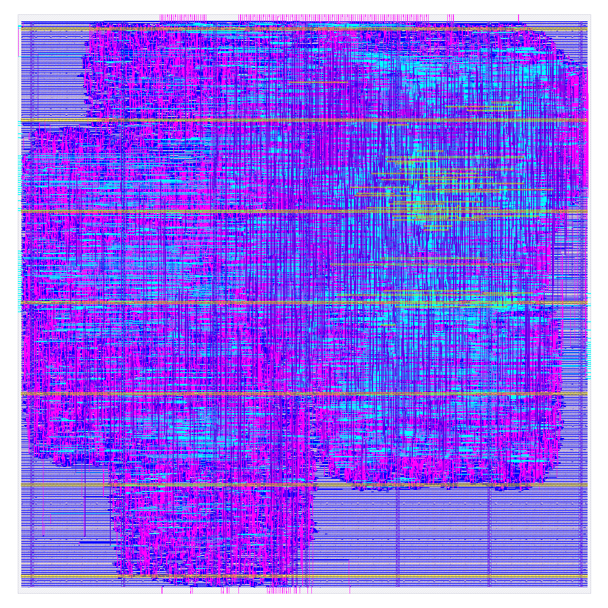
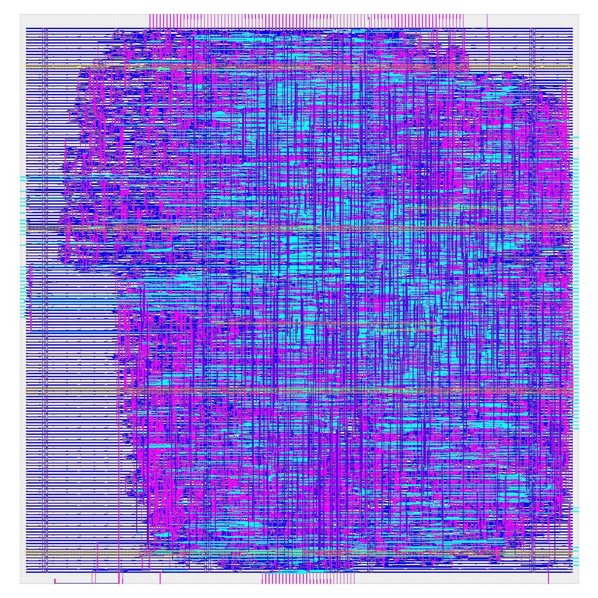

# Layout ASIC – OpenLane 2 / sky130A

OpenLane 2.3.10 (flow `Classic`, image Docker `ghcr.io/efabless/openlane2:2.3.10`), PDK sky130A (open_pdks `0fe599b`), thư viện cell `sky130_fd_sc_hd`. Chỉ làm layout cho **lõi** (cổng Wishbone là chân I/O của khối); RAM 128 KB của SoC không đưa vào vì flow không có macro SRAM (quyết định D30). Sinh bởi `scripts/run_asic.py` (`make asic`).

## Bảng A1 – Kết quả place & route

| Chỉ số | `rv_core` | `rv_core_sc` |
|---|---|---|
| Chu kỳ ràng buộc (SDC) | 25 ns (40 MHz) | 25 ns (40 MHz) |
| Kích thước die | 961.8 × 972.5 µm (0.935 mm²) | 527.7 × 538.4 µm (0.284 mm²) |
| Số cell chuẩn (gồm tap, fill, diode, buffer) | 62,600 | 18,069 |
| Diện tích cell chuẩn | 459,999 µm² | 139,680 µm² |
| Mật độ (utilization) | 51.0 % | 52.6 % |
| Tổng chiều dài dây | 1,761,890 µm | 548,711 µm |
| Setup slack / Fmax – TT 25 °C 1,80 V | +9.85 ns / **66.0 MHz** | +5.46 ns / **51.2 MHz** |
| Setup slack / Fmax – SS 100 °C 1,60 V | -3.99 ns / **34.5 MHz** | -4.08 ns / **34.4 MHz** |
| Setup slack / Fmax – FF −40 °C 1,95 V | +13.56 ns / **87.4 MHz** | +8.80 ns / **61.7 MHz** |
| Hold slack (TT) | +0.304 ns | +0.322 ns |
| Công suất tổng (TT, ước lượng) | 80.00 mW | 7.50 mW |
| – trong đó: internal / switching / leakage | 34.14 mW / 45.86 mW / 0.50 µW | 4.79 mW / 2.71 mW / 0.16 µW |
| DRC (Magic / KLayout / router) | 0 / 0 / 0 | 0 / 0 / 0 |
| LVS (Netgen) – số lỗi | 0 | 0 |
| Antenna – số net vi phạm | 26 | 8 |
| XOR GDS Magic ↔ KLayout | 0 | 0 |
| Vi phạm max slew / max cap – TT | 7 / 21 | 15 / 0 |
| Vi phạm max slew / max cap – góc xấu nhất | 1,187 / 44 | 347 / 0 |
| Gate-level (netlist sau đi dây) ≡ RTL | 64/64 riscv-tests | 41/41 riscv-tests |

Fmax = 1 / (chu kỳ ràng buộc − setup slack) tại từng góc PVT, theo STA của OpenROAD sau đi dây (có ký sinh SPEF). Công suất do OpenSTA ước lượng với hoạt động chuyển mạch mặc định, không lấy từ mô phỏng – chỉ dùng để so sánh tương đối. Gate-level: netlist cuối cùng chạy bằng Icarus Verilog với mô hình chức năng `sky130_fd_sc_hd`, cùng testbench `tb/asic/tb_core_gl.v` với RTL (Verilator); một test khớp khi cả hai PASS với cùng số chu kỳ, số lần ghi và chữ ký ghi bộ nhớ (`results/asic/gl_<top>.csv`).

## Hình

*Layout `rv_core` (GDS cuối, KLayout).* Đường găng: `results/asic/timing_rv_core.txt`.

*Layout `rv_core_sc` (GDS cuối, KLayout).* Đường găng: `results/asic/timing_rv_core_sc.txt`.

Tái tạo: `make asic` (lần đầu khoảng 1 giờ; kết quả cũ được dùng lại nếu RTL và `asic/<top>/config.json` không đổi).
