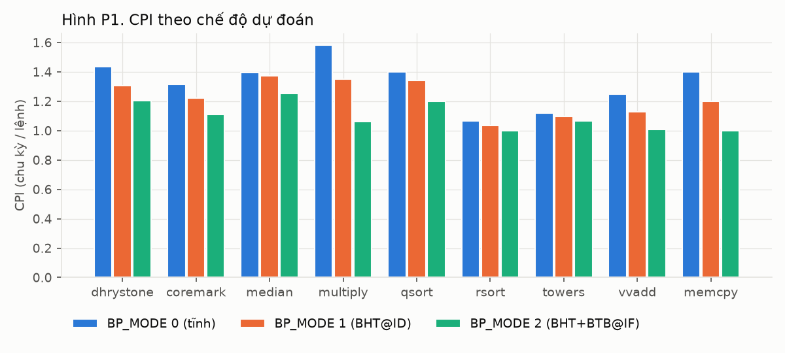
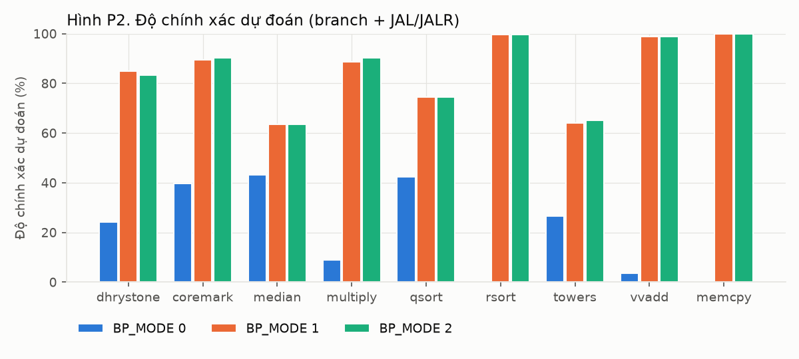
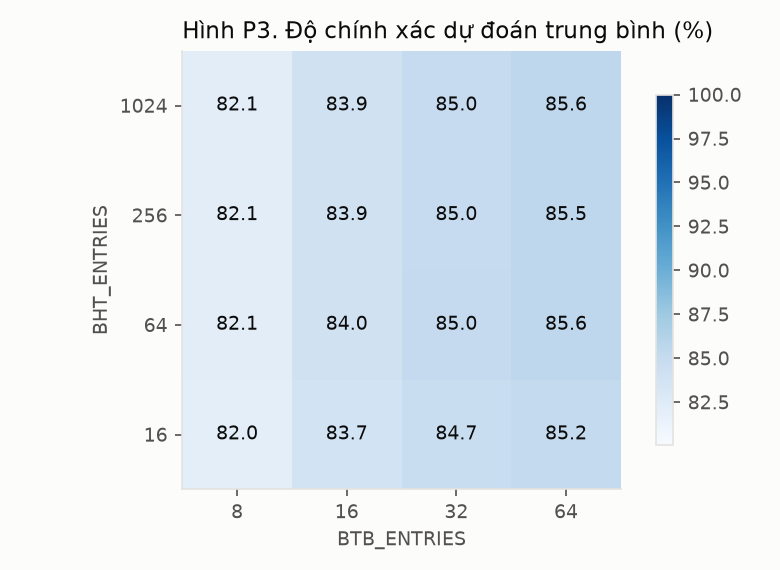
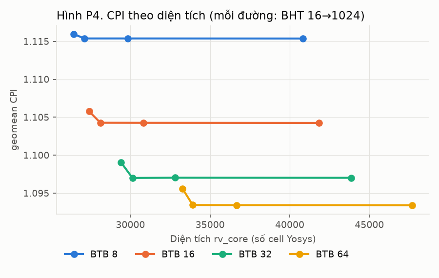
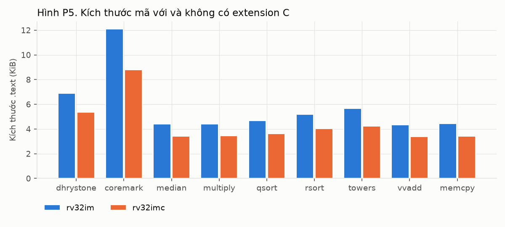
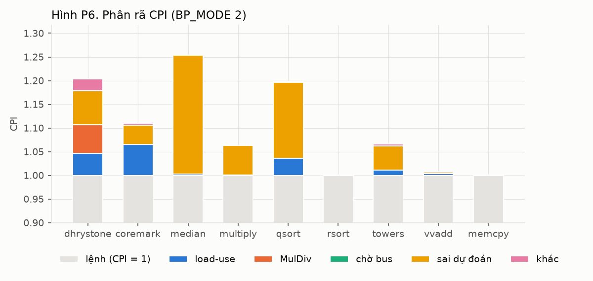

# Đánh giá hiệu năng

Số liệu đo trong vùng đo của từng benchmark (giữa hai lần `setStats`/`start_time`) bằng `mcycle`, `minstret`, `mhpmcounter3..10`. Tái tạo: `make perf` (= `.venv/bin/python scripts/run_perf.py`).

## Thí nghiệm 1 – Bộ dự đoán rẽ nhánh (rv32imc, BHT 256, BTB 32)

Bảng P1. CPI, độ chính xác dự đoán (branch + jump) và chu kỳ penalty (toàn chương trình = 2×redirect ở EX + 1×redirect ở ID). Nguồn: `results/perf/exp1_predictor.csv`.

| Benchmark | CPI BP0 | CPI BP1 | CPI BP2 | Acc BP0 | Acc BP1 | Acc BP2 | Penalty BP0 | Penalty BP1 | Penalty BP2 |
|---|---|---|---|---|---|---|---|---|---|
| dhrystone | 1.435 | 1.307 | 1.204 | 24.2% | 85.0% | 83.3% | 98704 | 60615 | 27516 |
| coremark | 1.314 | 1.220 | 1.110 | 39.8% | 89.5% | 90.2% | 165288 | 108586 | 29885 |
| median | 1.396 | 1.375 | 1.255 | 43.1% | 63.6% | 63.6% | 5276 | 4725 | 2414 |
| multiply | 1.585 | 1.350 | 1.063 | 8.9% | 88.7% | 90.2% | 26096 | 16508 | 2884 |
| qsort | 1.399 | 1.341 | 1.199 | 42.3% | 74.5% | 74.5% | 90000 | 68981 | 23089 |
| rsort | 1.066 | 1.033 | 1.000 | 0.7% | 99.7% | 99.6% | 32226 | 16377 | 353 |
| towers | 1.119 | 1.099 | 1.067 | 26.6% | 64.0% | 65.1% | 2412 | 1656 | 678 |
| vvadd | 1.250 | 1.129 | 1.008 | 3.5% | 98.7% | 98.7% | 2984 | 1645 | 246 |
| memcpy | 1.399 | 1.200 | 1.001 | 0.4% | 99.9% | 99.9% | 21508 | 10905 | 250 |
| **geomean CPI** | 1.320 | 1.223 | 1.097 | | | | | | |

## Thí nghiệm 2 – Quét kích thước BHT × BTB (BP_MODE 2)

Bảng P2. Độ chính xác trung bình (%) / geomean CPI trên 9 benchmark; diện tích = số cell Yosys của `rv_core` (generic, không tính RAM). Nguồn: `results/perf/exp2_sweep.csv`, `results/synth/summary.json`.

| BHT \ BTB | 8 | 16 | 32 | 64 |
|---|---|---|---|---|
| 16 | 82.0% / 1.116 / 26426 cell | 83.7% / 1.106 / 27402 cell | 84.7% / 1.099 / 29403 cell | 85.2% / 1.096 / 33265 cell |
| 64 | 82.1% / 1.115 / 27123 cell | 84.0% / 1.104 / 28115 cell | 85.0% / 1.097 / 30127 cell | 85.6% / 1.093 / 33911 cell |
| 256 | 82.1% / 1.115 / 29828 cell | 83.9% / 1.104 / 30808 cell | 85.0% / 1.097 / 32797 cell | 85.5% / 1.093 / 36671 cell |
| 1024 | 82.1% / 1.115 / 40824 cell | 83.9% / 1.104 / 41822 cell | 85.0% / 1.097 / 43843 cell | 85.6% / 1.093 / 47685 cell |

## Thí nghiệm 3 – Extension C

Bảng P3. Kích thước `.text` (byte) và CPI của ELF rv32im so với rv32imc, cùng lõi `m1c1_bp2`. Nguồn: `results/perf/exp3_rvc.csv`.

| Benchmark | .text im | .text imc | Giảm | Lệnh nén (%) | Chu kỳ im | Chu kỳ imc | CPI im | CPI imc |
|---|---|---|---|---|---|---|---|---|
| dhrystone | 7068 | 5488 | 22.4% | 54.5% | 338104 | 333617 | 1.220 | 1.204 |
| coremark | 12404 | 8992 | 27.5% | 54.8% | 702058 | 695588 | 1.120 | 1.110 |
| median | 4496 | 3504 | 22.1% | 64.7% | 5402 | 5404 | 1.254 | 1.255 |
| multiply | 4508 | 3520 | 21.9% | 83.1% | 22282 | 22282 | 1.063 | 1.063 |
| qsort | 4796 | 3716 | 22.5% | 42.9% | 148615 | 148150 | 1.203 | 1.199 |
| rsort | 5328 | 4140 | 22.3% | 47.3% | 171250 | 171242 | 1.000 | 1.000 |
| towers | 5812 | 4332 | 25.5% | 66.1% | 4037 | 4028 | 1.069 | 1.067 |
| vvadd | 4440 | 3468 | 21.9% | 74.1% | 2489 | 2489 | 1.008 | 1.008 |
| memcpy | 4536 | 3516 | 22.5% | 40.0% | 20110 | 20110 | 1.001 | 1.001 |
| **tổng** | 53388 | 40676 | 23.8% | | | | | |

## Thí nghiệm 4 – Phân rã CPI (m1c1_bp2, rv32imc)

Bảng P4. CPI = 1 (lệnh) + các thành phần stall/lệnh. `mispredict` = 2 chu kỳ × số lần sai dự đoán ở EX; `other` = phần còn lại (chủ yếu redirect 1 chu kỳ ở ID cho JAL). Nguồn: `results/perf/exp4_cpi_breakdown.csv`.

| Benchmark | CPI | load-use | MulDiv | bus | mispredict | other |
|---|---|---|---|---|---|---|
| dhrystone | 1.204 | 0.047 | 0.059 | 0.000 | 0.072 | 0.025 |
| coremark | 1.110 | 0.065 | 0.000 | 0.000 | 0.041 | 0.004 |
| median | 1.255 | 0.002 | 0.000 | 0.000 | 0.252 | 0.001 |
| multiply | 1.063 | 0.001 | 0.000 | 0.000 | 0.063 | 0.000 |
| qsort | 1.199 | 0.036 | 0.000 | 0.000 | 0.161 | 0.003 |
| rsort | 1.000 | 0.000 | 0.000 | 0.000 | 0.000 | 0.000 |
| towers | 1.067 | 0.012 | 0.000 | 0.000 | 0.051 | 0.004 |
| vvadd | 1.008 | 0.004 | 0.000 | 0.000 | 0.003 | 0.001 |
| memcpy | 1.001 | 0.001 | 0.000 | 0.000 | 0.000 | 0.000 |

## Thí nghiệm 5 – Single-cycle so với pipeline

Bảng P5. CPI (geomean), Fmax ước lượng của SoC tương ứng (nextpnr ECP5, RAM 1 KB, xem `results/synth/summary.md`) và hiệu năng tương đối ∝ Fmax / CPI (chuẩn hóa theo lõi single-cycle). Nguồn: `results/perf/exp5_sc_vs_pipeline.csv`.

| Lõi | geomean CPI | Dhrystone CPI | Fmax (MHz) | Fmax/CPI | Hiệu năng tương đối |
|---|---|---|---|---|---|
| rv_core_sc (single-cycle, RV32I) | 1.000 | 1.000 | 25.59 | 25.6 | 1.00× |
| rv_core pipeline RV32I | 1.104 | 1.178 | 47.16 | 42.7 | 1.67× |
| rv_core pipeline RV32IMC | 1.097 | 1.204 | 42.27 | 38.5 | 1.51× |

## Kiểm tra hợp lý (spec 12.1)

| Kiểm tra | Kết quả | Giá trị |
|---|---|---|
| CPI Dhrystone (BP2) trong [1.0, 2.0] | ĐẠT | 1.204 |
| BP_MODE=2 không tệ hơn BP_MODE=0 (mọi benchmark) | ĐẠT | đạt |
